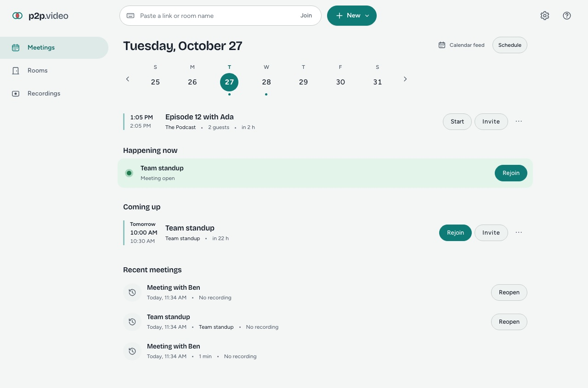
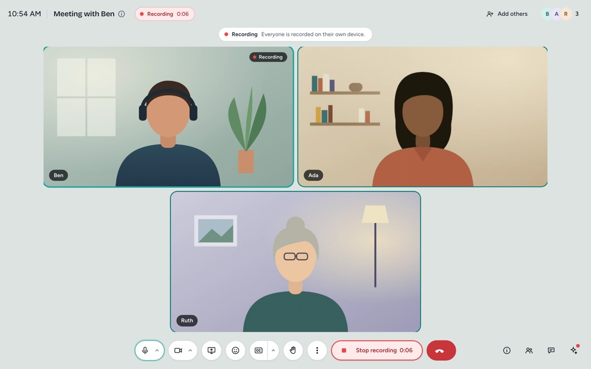
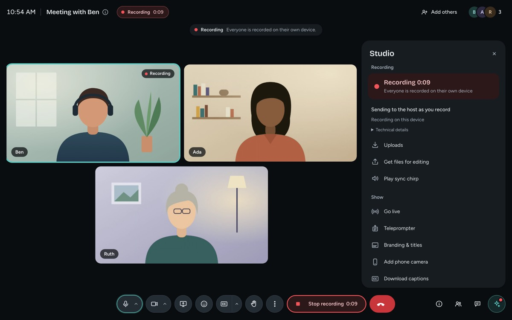

# p2p.video

**Video calls and a recording studio you host on your own Mac.** p2p.video is an open-source
alternative to Google Meet and Riverside.fm: guests join from a link in their browser, and
every participant is recorded locally, on their own device, at full quality. The host Mac
collects those isolated tracks and turns them into files your editor opens. No accounts, no
subscriptions, no cloud: your calls and recordings stay on machines you control.






## What it does

- **Calls**: links that work in Chrome, Safari and Firefox without an install; reusable rooms
  with a waiting room and admission; group calls, chat, reactions, raise hand, screen share,
  layouts, background blur, keyboard shortcuts, scheduling with calendar invites.
- **Recording studio**: one isolated camera + microphone track per person, recorded on their
  own device independently of call quality, with an optional uncompressed WAV microphone track.
  Progressive upload with crash and tab-close recovery, a phone as an extra camera, separate
  screen-share track, pre-flight checks, solo "record on your own time" links, producers,
  teleprompter, branding and lower thirds.
- **After the take**: an editor package with one aligned track per person (FCPXML for Final
  Cut Pro and DaVinci Resolve, FCP7 XML for Premiere), transcripts with exact speaker names
  from Apple's on-device speech recognition, live captions, livestreaming over RTMP(S), and
  optional hand-off to a Parachute notes vault or the `ave` clip editor.

See [docs/PARITY.md](docs/PARITY.md) for what is verified on real devices and what has only
been tested synthetically.

## Install (Mac)

Requirements: an Apple Silicon Mac with macOS 14 or later for the host. Guests only need a
current browser.

1. Download `p2p.video-1.0.0-arm64.dmg` from the
   [Releases](https://github.com/omniharmonic/p2p.video/releases) page.
2. Open it and drag **p2p.video** to Applications, then open it. It starts the host, adds an
   icon to the menu bar and opens a setup guide (Tailscale, guest links, browser, first room).
3. Read [Getting Started](docs/INSTALL_MAC.md) for guests, recording, exports and recovery.

FFmpeg and ffprobe (LGPL builds, with their source) are inside the app; you do not need
Homebrew, Go or Node.js. Remote guests need Tailscale on the host (see below).

Coming from **StudioLink** (this project's previous name)? Quit StudioLink first. On first
launch p2p.video moves `~/Library/Application Support/StudioLink` to
`~/Library/Application Support/p2p.video` once, keeping rooms, recordings and settings
([details](docs/DESKTOP_APP.md#migrating-from-studiolink-sl-rel-1)).

## How it works

```
 guest browser ──┐                                   ┌── host Mac ─────────────────────────┐
 guest browser ──┼── HTTPS + WebRTC over Tailscale ──┤ p2pvideod (Go): web app, signaling, │
 phone camera  ──┘   (Serve: tailnet; Funnel: link)  │ SFU, TURN, uploads, export (FFmpeg) │
                                                     │ p2p.video.app (Swift): menu bar,    │
                                                     │ supervisor, on-device speech        │
                                                     └─────────────────────────────────────┘
```

- **Reaching your Mac: Tailscale.** The host listens on loopback only. Tailscale Serve
  publishes it to your tailnet over HTTPS (guests you share the machine with), or Tailscale
  Funnel publishes only the guest page to anyone with a link. The host dashboard and admin
  API are never exposed through Funnel. Nothing is configured without your click.
- **The call: P2P and SFU.** Calls use WebRTC through a Go selective forwarding unit
  ([Pion](https://github.com/pion/webrtc)) on the host, with an embedded TURN relay for
  guests behind strict networks. Public STUN is a setting you can switch off.
- **The recording: local ISO.** Each browser records its own camera and microphone with
  MediaRecorder (and optionally AudioWorklet PCM), journals chunks to its Origin Private File
  System, and uploads them to the host with integrity checks. The recording never uses
  the call's received media, so a bad connection does not damage the recording.
- **Export.** The host aligns tracks from each device's clock and an acoustic check, conforms
  them with FFmpeg, and writes the editor package under your data folder.

Architecture: [docs/ARCHITECTURE.md](docs/ARCHITECTURE.md). Desktop app:
[docs/DESKTOP_APP.md](docs/DESKTOP_APP.md). Guests without Tailscale:
[docs/PUBLIC_GUESTS.md](docs/PUBLIC_GUESTS.md).

## Privacy

- Media, recordings, transcripts and settings stay on the host Mac and the participants'
  devices. There is no p2p.video server, account, analytics or telemetry.
- Captions and transcripts use Apple's on-device speech recognition; audio never leaves the Mac.
- Background effects run MediaPipe locally in the browser; its usage logging is blocked.
- Optional network services are your choice: Tailscale for reachability, public STUN (off-able),
  and the RTMP destinations you add for a livestream.
- Security model and how to report a vulnerability: [docs/SECURITY.md](docs/SECURITY.md).

## Build from source

You need Go (version in `host/go.mod`), Node.js with pnpm, and for the Mac app Xcode command
line tools (Swift 6). FFmpeg and ffprobe must be on `PATH` to run the host from source.

```sh
cd web && pnpm install --frozen-lockfile && cd ..
make build        # web assets, then bin/p2pvideod (host) and bin/p2pvideo (CLI)
make dev          # host on 127.0.0.1:7443 with a .studio-dev data folder; opens the dashboard
make test         # Go, web unit tests and Mac app unit tests
make e2e          # browser end-to-end suites (Playwright Chromium)
```

Run the host by hand:

```sh
./bin/p2pvideod --data-dir /path/to/data --port 7443 --no-funnel
./bin/p2pvideo dashboard --data-dir /path/to/data --open   # opens the signed-in dashboard
```

Package the Mac app (ad-hoc signed unless `DEVELOPER_ID_APPLICATION` / `NOTARYTOOL_PROFILE`
are set):

```sh
scripts/build-ffmpeg-mac.sh     # LGPL FFmpeg 9.0.2 from verified source
scripts/package-mac.sh          # build/p2p.video.app, .dmg, .zip, SHA256SUMS.txt
```

Contributing: [CONTRIBUTING.md](CONTRIBUTING.md). Project status and verification log:
[STATUS.md](STATUS.md).

## License

p2p.video is free software: you can redistribute it and/or modify it under the terms of the
[GNU Affero General Public License v3](LICENSE). If you run a modified version for others over
a network, the AGPL asks you to offer them its source; the app links to its source on the
home screen, the join and record pages and in the Mac app's About box.

Third-party components (FFmpeg under LGPL-2.1+, MediaPipe under Apache-2.0, the Figtree and
Bricolage Grotesque fonts under OFL-1.1, Pion and other Go modules, Sparkle when enabled) are
listed with their licenses in [THIRD_PARTY_NOTICES.md](THIRD_PARTY_NOTICES.md).
