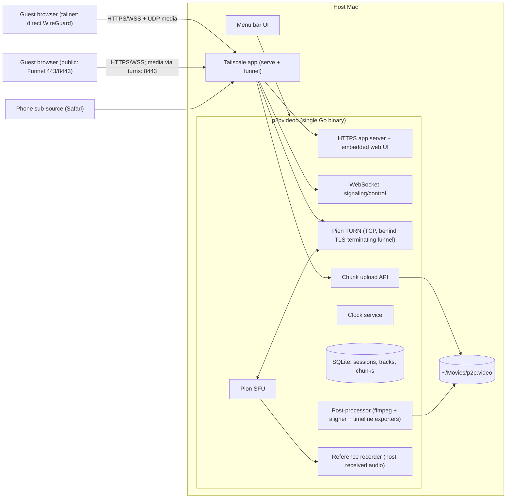
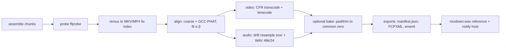

# p2p.video: Technical Architecture

> Companion to [PRD.md](PRD.md). The deep feasibility research behind this is in [research/webrtc-tailscale-feasibility.md](research/webrtc-tailscale-feasibility.md). Read §1, §3 and §4 of that report before changing anything in sections 3–6 below.

## 1. System overview



**Main design decisions** (full list in [DECISIONS.md](DECISIONS.md)):

| # | Decision | Why |
|---|---|---|
| D1 | **The host is the server.** One Go binary `p2pvideod` does web, signaling, SFU, TURN, upload and post-processing | No hosted infrastructure. Go has the full stack natively: Pion, pion/turn, tsnet, tusd |
| D2 | **Star topology with the host as SFU** (not a P2P mesh) | Every file ends at the host anyway. Funnel only reaches the host. Guest uploads stay at 1× |
| D3 | **Tailscale.app + LocalAPI** for Serve/Funnel in the MVP; **tsnet** embedding later | tsnet + Pion UDP integration is fiddly (custom `transport.Net`). With the system Tailscale, Pion just binds the 100.x interface |
| D4 | **Recording is decoupled from the call.** Each source records its own full-resolution capture; the call sends a downscaled encoding of the same track | Call quality never affects the recording |
| D5 | **Three-layer sync:** scheduled start on the host clock, an NTP-style sidecar, then **audio cross-correlation against the host-received reference** for sample-accurate offset + drift | Hardware clocks drift 70–360 ms/h. Cross-correlation against the host's own copy of each source is robust |
| D6 | **Numbered-chunk uploads** (`PUT …/chunks/{seq}` with SHA-256), not tus, in the MVP | Simpler. Naturally resumable and idempotent. Maps 1:1 to OPFS chunks |
| D7 | **The web client is TypeScript + Vite + Svelte 5**, embedded in the binary via `embed.FS` | Small bundle, reactive dashboard, easy for agents to work in |
| D8 | **Output keeps the media untouched where possible** and puts offsets in the timelines; it also offers "baked" aligned files | Editors prefer original media plus a timeline. Baked files are for the "just drop them in" case |

## 2. Repository layout

```
p2p.video/
  README.md  AGENTS.md  STATUS.md
  docs/ PRD.md ARCHITECTURE.md IMPLEMENTATION_PLAN.md DECISIONS.md research/
  host/                         # Go module path keeps its pre-rename name: .../studiolink/host
    cmd/p2pvideod/main.go     # entrypoint (flags: --data-dir, --dev, --no-funnel)
    cmd/p2pvideo/main.go      # CLI for dev/test: create session, list, postprocess <take>
    internal/
      config/                   # config file + defaults
      tailscale/                # LocalAPI client: status, serve/funnel config, cert domain, checks
      httpserver/               # routes, auth middleware, static embed
      session/                  # session/participant/source/take state machine
      signaling/                # WS hub (hub*.go, file map §5.3), message types (protocol.go), admission
      sfu/                      # Pion peer per participant, track forwarding, RTCP, bitrate caps
      turn/                     # pion/turn server, HMAC creds, TLS-terminated listener
      clock/                    # host monotonic clock, ping handler, offset/drift fitting
      upload/                   # chunk PUT handler, checksum, assembly
      refrec/                   # writes host-received Opus per source to OGG (sync reference)
      store/                    # SQLite (modernc.org/sqlite, no CGO), migrations
      postproc/                 # pipeline orchestrator, ffmpeg wrapper, job queue
      align/                    # GCC-PHAT cross-correlation, line fit, drift ratio
      export/fcpxml/ export/xmeml/ export/manifest/
      ffmpeg/                   # discovery, capability probe, command builders
      livestream/               # P3: browser-composited ingest → ffmpeg → RTMP(S) tee (docs/LIVESTREAM.md)
    web/                        # embedded build output (generated; gitignored except .keep)
  web/                          # TypeScript client (Vite, plain TS + DOM components; as built, no Svelte)
    src/
      main.ts                   # composition root only (module map §4.6) [SL-TECH-1]
      app/                      # app modules: state, dom, signaling, call, media, recording, dashboard, greenroom, studio, ui
      components/               # UI components (one class/mount function each, own CSS)
      lib/protocol.ts           # generated from host/internal/signaling/protocol.go (or hand-mirrored + tests)
      lib/rtc/                  # peer connection, SFU negotiation, ICE config
      lib/capture/              # device enumeration, getUserMedia, track cloning, constraints
      lib/recorder/             # Recorder interface; WebCodecsRecorder, MediaRecorderRecorder, PcmWorkletRecorder
      lib/storage/              # OPFS chunk store (worker + SyncAccessHandle), IDB fallback
      lib/upload/               # upload queue, throttling, resume
      lib/clock/                # ping loop, offset estimate, sidecar writer
      routes/                   # green room, studio, host dashboard, phone source, recovery
    tests/                      # vitest unit + playwright e2e (fake media devices)
  macapp/                       # thin Swift menu-bar wrapper that launches/monitors p2pvideod (P1; MVP can use systray in Go)
  testdata/                     # sample clips, chirp fixtures
```

## 3. Networking and Tailscale

### 3.1 Connectivity tiers
| Tier | Who | Page/WS/upload path | Media path |
|---|---|---|---|
| A | Guest has Tailscale, host shared the node with them | `https://studio.<tailnet>.ts.net` resolves to 100.x (WireGuard, usually direct) | UDP ICE host candidates on the 100.x interface |
| B1 | Public guest, direct UDP possible | Funnel :443 | UDP to the host's public IP (srflx through STUN, or UPnP/NAT-PMP mapped port) |
| B2 | Public guest, UDP blocked or symmetric NAT | Funnel :443 | `turns:studio.<tailnet>.ts.net:8443?transport=tcp`: Funnel terminates TLS, then plain TCP to pion/turn, which relays to the SFU on loopback |
| C | Same LAN | Tailnet URL (secure context) | LAN host candidates |

The same invite URL works for every tier (MagicDNS inside the tailnet, public DNS to Funnel outside).

### 3.2 Tailscale configuration (applied by `internal/tailscale` via LocalAPI; CLI equivalent shown)
```
tailscale serve  --bg --https=443  http://127.0.0.1:7443      # app (HTTP+WS+upload)
tailscale funnel --bg --https=443  on
tailscale serve  --bg --tls-terminated-tcp=8443 tcp://127.0.0.1:3478   # TURN over TLS
tailscale funnel --bg 8443 on
```
- `p2pvideod` listens **only on 127.0.0.1** for HTTP (7443) and TURN-TCP (3478), plus the SFU UDP mux port on the tailnet and public interfaces (configurable, default 50000/udp).
- Real client IPs: enable PROXY protocol on serve, or rely on Tailscale's `Tailscale-User-*` / `X-Forwarded-For` headers for tailnet requests.
- Onboarding checks: `tailscale status --json` → `Self.DNSName`, `CertDomains` non-empty, `Capabilities` contains funnel, HTTPS enabled.
- **[RISK, Spike S1]** Verify that `--tls-terminated-tcp` on a funnel port behaves as expected for TURN. Fallback: use tsnet `ListenFunnel` + our own TLS, and demux STUN magic cookie vs HTTP on 443.

### 3.3 ICE configuration sent to clients (over WS after admission)
```json
{ "iceServers": [
   { "urls": ["stun:stun.cloudflare.com:3478"] },                       // optional, policy-controlled
   { "urls": ["turns:studio.tail1234.ts.net:8443?transport=tcp"],
     "username": "1760380000:pid_abc", "credential": "<HMAC-SHA1(secret, username)>" } ],
  "iceTransportPolicy": "all" }
```
TURN credentials use the TURN REST convention (expiry:participantId), with 6 h TTL.

### 3.4 As implemented (SL-P0-1, 2026-10-25)
See `docs/PUBLIC_GUESTS.md` for the operator commands and flags.
- `internal/turn` embeds pion/turn **v5** (the major already pulled in by pion/ice v4). It runs TURN over TCP on `--turn-listen` (default `127.0.0.1:3478`, loopback enforced). The secret is per daemon run and memory only.
- **Relay address generator:** static on `127.0.0.1`. Relay sockets bind to loopback and reach the SFU through its loopback host candidate. Peer permissions are loopback-only, outgoing relayed datagrams are filtered to the SFU mux port, and RFC 6062 TCP allocations are refused. So the relay can't send off-host, and no relay port range needs opening.
- `iceServers` are built by `signaling.BuildICEServers` and sent only in an `admitted` admission. That's public STUN when policy allows (`--no-public-stun`), plus TURN when the relay is running and `--funnel-turn` / `--turn-url` advertise it. The TURN auth handler also checks that the participant is still admitted or briefly disconnected, so denying a participant revokes their relay.
- SFU: `SettingEngine` with `ice.NewMultiUDPMuxFromPort(--udp-port, default 50000)`, which binds one socket per interface address, loopback included. It falls back to IPv4-only, then to ephemeral ports with a warning, if the port is busy. The SFU's own PeerConnections get public STUN (when allowed) for srflx. In pion, srflx gathers on ephemeral sockets, not the mux port. The mux enumerates interfaces once at start, so an interface that appears later (for example Tailscale coming up after the daemon) gets no host candidate until restart.
- A host-token WebSocket carrying `Tailscale-Funnel-Request` is refused (403). Host control is management.

## 4. Media plane

### 4.1 SFU (`internal/sfu`)
- One `webrtc.PeerConnection` per participant/sub-source. Each publishes 1 audio + N video tracks and subscribes to the others (start with Pion's `sfu-ws` example pattern; renegotiate on track add).
- `SettingEngine`: `SetICEUDPMux` on a single port (implemented: `sfu.WithNetwork`, see §3.4), `SetNAT1To1IPs` (when UPnP mapping is active, not implemented), `SetNetworkTypes` udp4/tcp4 (pion defaults kept).
- Bitrate caps (client-side, `callEncodingPolicy` in `web/src/lib/rtc.ts`): the publisher sends a single encoding whose `scaleResolutionDownBy` brings the capture's short side to the tier, re-applied with `setParameters` whenever the participant count changes. 1–2 participants: 720p / 1.5 Mbps / 30 fps; 3–4: 540p / 900 kbps / 30 fps; 5+: 360p / 500 kbps / 24 fps. Video uses `degradationPreference: maintain-framerate`; Opus is capped at 64 kbps. The capture track itself (and so every recorder) stays at full resolution. Simulcast is off in v1. Since SL-P0-8 the tier also follows the network (§4.5): a relayed path sends one tier lower, and measured congestion steps further down to 270p/300 kbps/20 fps and 180p/150 kbps/15 fps (Opus 32 kbps at the bottom tier), recovering upward with hysteresis.
- Media recovery: the client treats `connectionState` `failed`, or `disconnected` for more than 5 s, or no connection 20 s after an offer, as dead media. It builds a new `RTCPeerConnection` and re-offers over the existing WebSocket (first retry immediate, then 1/2/4/8 s backoff). `HandleOffer` on a participant that already has a peer replaces it: the old peer's publications are removed, the others renegotiate, and they re-subscribe once the new peer's tracks arrive. We chose replacement over ICE restart because the server may have its own subscription offer in flight (glare), a failed DTLS/SRTP association can't be revived by ICE restart, and a failed server peer may already have been removed. Server offers that reach the client while its own offer is pending belong to the replaced peer and are ignored. Capture, recorders and uploads are untouched, and the participant's reference recording is not stopped on replacement.
- Screen share (SL-P1-2, DECISIONS 2026-10-25): a participant publishes its screen (video + optional tab/system audio) as extra tracks on its **existing** PeerConnection. It first sends `source_add {kind: screen, trackIds}`; the hub allows one presenter per room and calls `SFU.SetScreenTracks`, and the roster marks the presenter (`screenSharing`). The client then adds the tracks on fresh `sendrecv` transceivers (`addTransceiver`, never `addTrack`, which would reuse an idle subscription m-line the SFU won't receive on) and sends a **client renegotiation**: `sdp_offer` with `renegotiate: true`, applied by `SFU.HandleRenegotiation` to the same peer (no replacement). Glare: the server is the impolite peer. If its own subscription offer is outstanding it drops the client offer (`ErrGlare`), and the client, which is in `have-local-offer` when that server offer arrives, rolls back, answers, and re-offers. An unanswered renegotiation falls back to media recovery after 10 s. The SFU forwards declared screen tracks with stream ID `<participantId>_screen`, so receivers tell them from the camera (`<participantId>`). Screen audio never feeds the reference recorder. Stopping (our button, the browser's native "Stop sharing" bar via track `ended`, or the host) removes the senders and renegotiates. Pion then stops the receiver and the publication is dropped. `source_remove`/`screen_stop` also clear the declaration, so `SetScreenTracks(nil)` unpublishes immediately even if the sharer's client misbehaves. On media recovery or reconnect, the client re-declares and republishes the share in its full offer.
- Screen sender caps (`screenEncodingPolicy`): `contentHint = 'detail'`, `maintain-resolution`, short side ≤1080 at 2.5 Mbps/15 fps for ≤4 participants, 1.5 Mbps/10 fps for 5–8, 720p/1 Mbps/8 fps beyond. Shared audio is capped at 96 kbps. Camera senders keep `callEncodingPolicy`.
- Call views (SL-P1-4, `web/src/components/LayoutSwitcher.ts`): Grid, Speaker, Focus (manual) and Switcher. While a screen tile exists, Grid and Speaker use the presentation layout: the screen on the stage (`object-fit: contain`) and the presenter's camera first in the filmstrip. Pinning is local only and puts the pinned tile on the stage (from Grid it switches to Speaker). Self view can be hidden when someone else is visible. The active speaker is detected client-side from remote `inbound-rtp` `audioLevel` (`getStats`, every 300 ms), mapped to participants by track ID. `ActiveSpeakerDetector` adds hysteresis: a newcomer must be loudest for 400 ms and the current speaker keeps the stage at least 1.5 s, and silence keeps the last speaker. The stage layout reorders tiles with CSS `order`, so playing video elements are never moved in the DOM.
- Forward RTCP PLI/FIR from subscribers to publishers; send REMB/TWCC as appropriate (use `interceptor` registry defaults).
- **Reference recorder** (`internal/refrec`, as built SL-P0-10): while a take runs (hub `startRecording` → `References.StartTake`, stopped with the take), every participant's received **microphone** packets (never screen audio) go to `takes/<take>/refs/<participantId>.ogg` (Pion `oggwriter`, pre-skip 3840) plus `refs/<participantId>.pkt`, a binary log with one record per written packet: SSRC, RTP timestamp, host monotonic arrival time, decoded sample count. The log maps every decoded sample to its packet and the packet to the host clock (reconnects start a new SSRC segment; lost packets leave gaps). This is the alignment reference (§6) and is never exported.

### 4.2 Client capture and recording (`web/src/lib/capture`, `recorder`)
```
getUserMedia(preset)  ──► MediaStreamTrack (full res)
          │                  ├─► RTCRtpSender (encodings: scaleResolutionDownBy, maxBitrate)  → call
          │                  └─► Recorder (full res) → chunks → OPFS → upload queue
mic track ──► call (AEC as configured)
          └─► PcmWorkletRecorder (AudioWorklet, 48 kHz Float32 → Int24 WAV chunks)  [P1]
```
`Recorder` interface:
```ts
interface Recorder {
  readonly kind: 'video' | 'audio';
  readonly mime: string;                 // e.g. 'video/mp4;codecs=avc1.640028,mp4a.40.2'
  start(atLocalPerfTime: number): Promise<void>;
  stop(): Promise<void>;
  onChunk: (c: { seq: number; bytes: Uint8Array; firstMediaTimeUs?: number; perfTime: number }) => void;
  onSyncEvent: (e: { type: 'first-frame'|'first-sample'; perfTime: number; mediaTimeUs: number }) => void;
}
```
Choosing an implementation (capability-detected at the green room):
1. **WebCodecsRecorder** (Chromium; Safari if `MediaStreamTrackProcessor` exists): VideoEncoder H.264 High (`avc1.640028`), `prefer-hardware`, `latencyMode:'quality'`, 1080p30 at 8 Mbps, keyframe every 2 s. Muxed with **Mediabunny** to fragmented MP4, one fragment per chunk. Exact per-frame timestamps feed the sidecar.
2. **MediaRecorderRecorder** (fallback, Firefox): `video/mp4` if supported, otherwise `video/webm;codecs=vp9/vp8,opus`, `timeslice: 1000`, `videoBitsPerSecond` from the preset.
3. **PcmWorkletRecorder** (audio, P1): AudioWorklet posts 128-frame blocks, and a worker encodes WAV chunks (header patched on finalize, or raw PCM + header written by the host). Sample index is the sync clock.

**As built: recorder matrix per engine (SL-P1-12, 2026-10-26).** The WebCodecs path above is not built; every engine records with `LocalTrackRecorder` (MediaRecorder, `timeslice` 1000 ms, mime from `preferredMimeType`) plus the optional `LocalPcmRecorder` (float WAV; capture-clocked `MediaStreamTrackProcessor` engine where the browser has it, AudioWorklet otherwise, see below). Measured in `web/tests/crossbrowser.browser.mjs` / `iphone.browser.mjs` (Playwright 1.61.1: Chromium 149, WebKit 26.5, Firefox 151):

| Engine | Camera + mic file | Uncompressed mic | Local storage (`lib/opfs.ts` backend) | Call send codec |
|---|---|---|---|---|
| Chromium | `video/mp4` with the default H.264 session codec (Chromium 149's MediaRecorder put VP9 + Opus in it here); `video/webm;codecs=vp9,opus` otherwise | `MediaStreamTrackProcessor` (capture clock, device rate) ✅ | `opfs` (createWritable) | VP8 |
| Safari / WebKit (macOS 26.5) | `video/mp4` → H.264 (`avc1.42000a`) + AAC | AudioWorklet ✅ | `opfs` (createWritable, Safari 26+); `opfs-worker` (SyncAccessHandle in a worker) where createWritable is missing (Safari 15.2–18, exercised by deleting it); `memory` in a private window | VP8 (WebKit offers H.264 High first; `setCodecPreferences` moves VP8 first) |
| Firefox | `video/webm` → VP8 + Opus, **no container duration** (postproc measures it from packets) | AudioWorklet ✅ | `opfs` (createWritable) | VP8 (Playwright's Firefox has no OpenH264 at all) |

**Uncompressed mic engines (SL-QA-2, 2026-10-26).** An AudioWorklet's samples are pulled at the *output* device's render rate, not the microphone's: whenever rendering glitches under CPU load, Chromium drops the queued microphone input, so the PCM file holds less audio than the take lasted and falls behind its own camera audio (measured in the 10-minute rehearsal: 1.4 s and 2.6 s lost per 10 minutes, at the merge and at the previously certified commit; the camera's MediaRecorder audio from the same capture lost nothing). Where `MediaStreamTrackProcessor` exists (Chromium), `LocalPcmRecorder` therefore reads every captured `AudioData` frame on the capture clock (`sidecar.engine: "track-processor"`, device sample rate, up to 60 s queued while the page is busy). Its anchor (`pcm-capture-start-estimate`) is the first frame's capture timestamp mapped onto `performance.now()` by the smallest arrival delay seen in the first second. A capture gap of ≥ 1.5 frames (15 ms; re-chunked timestamps jitter up to ±10.6 ms, a microphone's not at all) is filled with silence of the same length (`pcm.gapFrames`, `pcm-gap-filled` events) so the file stays on the capture timeline; overlaps, slow device-clock drift and jumps > 10 s are left alone. Safari and Firefox keep the AudioWorklet engine (`pcm-render-start-estimate`) and its limitation. The same capture-clock jumps reach the camera files: Chromium's MediaRecorder then writes one Opus packet whose duration exceeds its samples (90 ms for 60 ms, at the same moment in every browser on the machine), so postproc's WAV conversion (`BuildAudioNormalizeArgs`) fills timestamp gaps over 15 ms with silence (`aresample=async=1:min_hard_comp=0.015`, before any drift resample) instead of closing them up, which had put the rest of the camera audio 30 ms ahead of its video.

Container/codec are whatever MediaRecorder reports (`sidecar.mimeType`); the host stores `.mp4` or `.webm` and postproc conforms every angle to the export codec, so an edit timeline mixes them freely. `ffmpeg.ProbeMedia` falls back to a packet scan (`PacketEndArgs`: latest pts + duration) when the container declares no duration (Firefox WebM). Clock samples clamp a sub-millisecond round trip to 1 µs because Firefox and Safari coarsen `performance.now()` (a fast localhost round trip measured 0, which the host reads as "no timing samples"). Safari's autoplay policy: remote media that `play()` refuses starts muted with a "Turn on call sound" button; the next tap or key press unmutes it (`components/SoundUnlock.ts`). Optional extras degrade with a reason and never block the call or the recording: background blur runs on both WebKit and Firefox through the canvas pipeline; call audio processing that a microphone can't apply (Firefox's fake device reports none) makes the call share the capture instead of failing to connect; speaker choice needs `setSinkId` plus listed `audiooutput` devices. The guest green room shows a note naming exactly what is missing (`lib/browsersupport.ts`), only for a non-Chromium guest and only when something is.

**Screen recording (SL-P1-2).** While a take records, a presenter's screen is recorded on the presenter's own device as a separate ISO source from the `getDisplayMedia` capture track (never from received WebRTC media). It goes through its own MediaRecorder (6 Mbps), OPFS chunks, upload queue and sidecar. The track is registered with `POST /takes/{id}/tracks {kind: video, source: "screen"}` and may be registered at any time while the take is recording: when the take starts during a share, or when a share starts mid-take. Its timeline offset comes from its own sidecar `recorder-start` event. Stopping the share mid-take finalizes that track at once; stopping the take finalizes it with the others. Completeness: every registered track must still assemble, but a screen track never satisfies (and is never part of) a participant's expected-recorder requirement (`ListMissingTakeParticipants` ignores `screen` sources). Postproc exports it as its own video angle ("<Name> Screen" in the multicam, `source: "screen"` in the manifest), with any shared audio as a separate WAV. It is conformed onto a fixed even canvas (`BuildScreenVideoArgs`: scale + pad, `-reinit_filter 0`) because windows can be odd-sized and resize mid-recording.

**Device switching mid-call (SL-P1-3).** The Devices popover changes camera, microphone (`getUserMedia` for the chosen device, swapped into the capture stream and into the call sender with `replaceTrack`, with no renegotiation or rejoin; the mic goes through `CallMicrophone` so host-mute still works) and speaker (`setSinkId` on every remote media element, including ones added later, where supported). Camera and microphone switching is **locked while a take is arming, recording or stopping** (DECISIONS 2026-10-25), so a recorder never loses its source mid-take. Speaker output can change any time.

Audio processing: the recording mic track requests `echoCancellation:false, noiseSuppression:false, autoGainControl:false` (raw), or EC + NS without AGC (clean) for someone without headphones (SL-P1-10, below). The green room asks guests whether they wear headphones. **[RISK]** Some browsers apply constraints per device rather than per track; Spike S3 measures this.

**As built (SL-P1-8, 2026-10-25).** Until now the capture mic actually opened with echo cancellation on (Chrome then also applied its default noise suppression and AGC) and the call sent a clone of it. Measured in Chromium: a device first opened with processing hands that processing to every later request for it (so the "raw" PCM capture was processed too); a device first opened raw gives later requests their own processing. The capture mic now opens raw (`captureAudioConstraints` in `lib/callmic.ts`) and `CallMicrophone.prepare` opens a separate processed capture of the same device for the call with the user's choice (noise suppression, echo cancellation, automatic gain; Devices popover, default on, remembered per browser). A clone is used when the choice equals the capture's processing. Host mute and self-mute act on whichever call track is in use. If a browser returns the wrong processing anyway (`SharedProcessingError`), the capture is reopened with the call's processing and the UI says the settings then also apply to the recording (locked while a take records).

**Recording mic mode (SL-P1-10, 2026-10-26).** The recording mic is no longer always raw. Each participant has a mode `auto | raw | clean` (`lib/micmode.ts`, green room "I'm wearing headphones" + "Recording microphone", the same controls in the Devices popover; locked while a take arms/records/stops). `auto` resolves to raw with headphones, clean without; the session default `recording_mic_mode` (Settings, also a room recording preset; pushed live in `room_state.recordingMicMode`) replaces `auto`; an explicit participant choice wins. Raw = EC/NS/AGC off; clean = EC + NS on, AGC off. Processing is requested with exact constraints (`openCaptureMic`/`openAudio` in `lib/callmic.ts`, ideal fallback on `OverconstrainedError`). Chromium allows **one processed capture configuration per device** (any of EC/NS/AGC on; a raw capture always coexists), measured, so:
```
raw   recording capture (raw) ──► recorders          call capture (its own processing) ──► call sender
clean recording capture (EC+NS, no AGC) ──► recorders
                         └── clone ──► call sender (call-audio switches disabled: the call shares the clean processing)
```
Switching to clean releases the call's own processed capture first; switching to raw stops the old clean capture before the call reopens its own. The recording is never changed to satisfy the call. The measured state (`RecordingMicState`: mode, resolved, reason, headphones, measured EC/NS/AGC, `followsCall`) goes to pre-flight (`recordingMic`, item "Recording mic"), the host's per-participant views and each track's sidecar (`micProcessing` → `manifest.json` sources and the originals manifest). The PCM mic opens with the same processing. Details and numbers: DECISIONS 2026-10-26.

**Call-path video effects (SL-P1-7, 2026-10-25).** Background blur/replace never touches the capture track or a recorder:
```
camera track (full res) ──► recorders (untouched)
     └──► BackgroundProcessor (lib/segmentation.ts) ──► processed track ≤720p ──► call sender (replaceTrack)
```
Chrome: `MediaStreamTrackProcessor` → composite on canvases → `VideoFrame` → `MediaStreamTrackGenerator` (keeps running in background tabs). Elsewhere: hidden `<video>` + `requestVideoFrameCallback` → `canvas.captureStream()`. Per frame: a 256-wide copy is segmented by MediaPipe's selfie segmenter (Tasks Vision 1.0.1, CPU/XNNPACK delegate by default), the confidence mask becomes a feathered alpha mask (smoothstep + temporal damping), the background is the frame blurred on a quarter-size canvas or a generated gradient, and the person is composited back at full output resolution. The output track stays the same across camera switches. A rolling fps monitor turns the effect off with a notice after 5 s below 15 fps (after a 4 s warm-up; a disabled camera doesn't count). Runtime files are served from our origin (`/mediapipe/vision_wasm_internal.{js,wasm}` copied from the pinned package with a SHA-256 check by `vite.config.ts`, and the committed `selfie_segmenter.tflite`); compiling the WASM needs CSP `script-src 'wasm-unsafe-eval'`. Measured (`web/tests/effects.browser.mjs`, 1280×720 camera): M2 Max with the real GPU (Chrome new headless, Metal): 30 fps, 7.5 ms/frame, the whole browser at 44% of one core with Strong blur vs 10% without; Chromium headless shell (software WebGL/canvas): 30 fps, 24 ms/frame, ~0.9 cores for the whole browser vs ~0.1 without the effect.

**Phone sub-source (PRD F3, SL-P1-9, 2026-10-25).** An admitted participant asks `POST /api/v1/sessions/{id}/subsource` (its participant grant as bearer) for a single-use capability (10 min, HMAC with its own domain, nonce spent at the WebSocket upgrade with `role=subsource`, only while the parent is admitted; ≤2 phones per participant). The participant's page draws the QR code locally (vendored MIT encoder) for `/phone.html?session=…&token=…`; on the local dashboard the server returns the HTTPS public URL as base, since a phone can't open localhost. The phone page (`src/phone.ts`, its own Vite entry) drops the token from the address bar, joins as `subsource` (admitted without a prompt and named "<Parent> · Phone" by the hub), publishes video only (its mic would echo next to its participant), is publish-only in the SFU (`SetPublishOnly`: no subscriptions), and records camera + raw room mic in every take through the normal recorder/OPFS/upload pipeline under its own grant. A phone that joins while a take records registers its track late (like a screen share); it is never an expected recorder. Postproc attributes its sources to the parent (`source: "phone"`, "<Name> Phone" multicam angle; never a speaker voice track). Reconnects use the phone's own grant (`SubsourceResume`). Removing a participant removes its phones.

**Leaving (SL-P1-6).** A guest's Leave closes its signaling socket and peer, stops its recorders (they flush their last chunk before the camera and mic are released) and shows a post-leave screen; uploads are page-wide and keep draining while the tab is open. Rejoin reacquires devices and reconnects with the in-memory resume grant (no admission prompt). The host has no leave-and-keep-running: the hub has no host-less meeting.

### 4.3 Chunk storage (`web/src/lib/storage`)
- OPFS layout: `/sessions/<sessionId>/<takeId>/<trackId>/<seq>.bin` plus `meta.json` (mime, codec, last seq, uploaded set).
- Writes go through a dedicated worker with `createSyncAccessHandle`. Call `navigator.storage.persist()` on join.
- As built (`lib/opfs.ts`, layout `takes/<takeId>/tracks/<trackId>/chunk_<seq>.bin` + `meta.json`): the backend is probed once per page (SL-P1-12). `opfs` writes on the main thread with `createWritable` (Chromium, Firefox, Safari 26+). `opfs-worker` writes whole files from `lib/opfs-sync-worker.ts` with a `FileSystemSyncAccessHandle` where `createWritable` is missing (Safari 15.2–18); reads, listing and removal stay on the main thread. `memory` is used when `getDirectory()` is missing or rejects (Safari private windows, Playwright's ephemeral WebKit contexts): fragments live in the tab until the host acknowledges them (`releaseUploaded`), so recording and progressive upload work but a closed tab loses the unsent tail and nothing is recoverable on reload. Pre-flight reports it as a warning ("Private browsing…"), not a block, and the guest's browser note says so.
- **Recovery screen**: on any visit with leftover data for this origin, list the unsent takes, then resume. Delete after the host confirms assembly.

### 4.4 Upload (`web/src/lib/upload`, `host/internal/upload`)
```
PUT /api/v1/takes/{takeId}/tracks/{trackId}/chunks/{seq}
Headers: Authorization: Bearer <participantToken>, X-Chunk-SHA256: <hex>, Content-Type: application/octet-stream
→ 201 (stored) | 200 (already have identical) | 409 (seq exists, hash mismatch) | 413 | 401/403
POST /api/v1/takes/{takeId}/tracks/{trackId}/complete   { "lastSeq": 3599, "totalBytes": 3.6e9, "sidecar": {...} }
GET  /api/v1/takes/{takeId}/tracks/{trackId}/status     → { "have": [[0,1200],[1202,1300]] }   // ranges, for resume
```
- Client queue (SL-P0-8, `web/src/lib/uploadpacer.ts`): one `UploadScheduler` per page gates every track's queue (global FIFO concurrency + token bucket); each queue runs up to 4 upload workers behind it. `NetMonitor` re-configures it every 2 s from the call's `getStats()` (§4.5): concurrency 2 while a take records (1 when relayed); **throttled** (concurrency 1, token bucket at 25% of `availableOutgoingBitrate`, 15% when quality is poor, 50% while the camera tier is still stepped down, floor 256 kbit/s) when the uplink is stressed; 4 with no take recording (**drain**, applied immediately on Stop). Backpressure only delays: every chunk is journaled in OPFS before it is queued, a failed chunk stays queued and on disk, and per-request timeouts allow for the body at 256 kbit/s (20 s + size/256 kbit/s) so big chunks on a slow uplink are not aborted.
- Upload backlog: each client reports `upload: {pendingBytes, rateBps, mode, concurrency, rateLimitBps?}` in `net_stats`; the host's Source health panel and people panel show "Uploading 18 MB · ~3 min left" per participant and a "keep the session open" summary until everyone's backlog is empty.
- Host writes `raw/<trackId>/<seq>.bin`, fsyncs, records the row in SQLite, and assembles on complete (byte concatenation in order for fMP4/WebM from one recorder).

### 4.5 Connection quality and network adaptation (SL-P0-8)
Every admitted client runs `NetMonitor` (`web/src/lib/netmonitor.ts`) on a 2 s timer over its call `RTCPeerConnection.getStats()`. The policy is pure and unit-tested in `web/src/lib/netquality.ts`, `rtc.ts` (tiers) and `uploadpacer.ts`. Nothing here reads or changes capture or recorders; only call senders and upload pacing react.

**Sample.** Selected candidate pair → path (`relay` if either candidate is relay; `tailnet` for 100.64.0.0/10 or fd7a:115c:a1e0::/48; else `direct`), RTT (pair `currentRoundTripTime`, else RTCP), `availableOutgoingBitrate`; `remote-inbound-rtp.fractionLost` (what the SFU receives from us; Pion's default interceptors send receiver reports); inbound loss and frames dropped as deltas since the previous sample; worst inbound jitter; the camera encoder's `qualityLimitationReason` (screen-share senders excluded via `media-source.trackIdentifier`).

**Quality level** (`classifyQuality`, then `QualityTracker`: worse must hold 2 samples, better 3):

| Level | Any of |
|---|---|
| poor | RTT ≥ 500 ms · loss ≥ 10% · estimate < 200 kbit/s · ≥ 30% frames dropped · peer failed/disconnected |
| fair | RTT ≥ 250 ms · loss ≥ 3% · estimate < 500 kbit/s · ≥ 10% frames dropped · jitter ≥ 40 ms · bandwidth-limited |
| good | none of the above |
| unknown | not connected yet |

"Bandwidth-limited" means `qualityLimitationReason == 'bandwidth'` **and** the estimate is below 1.1× our own cap: Chrome also reports `bandwidth` when our `maxBitrate` cap is what limits the encoder. A relayed path alone is not a quality problem.

**Camera tiers** (`CALL_TIERS`, `callEncodingPolicy(count, {path, bandwidthStep})`): tier = base(count) + 1 if relayed + bandwidth step, clamped to 4.

| Tier | Short side | Video | fps | Opus |
|---|---|---|---|---|
| 0 | 720 | 1.5 Mbit/s | 30 | 64 kbit/s |
| 1 | 540 | 900 kbit/s | 30 | 64 kbit/s |
| 2 | 360 | 500 kbit/s | 24 | 64 kbit/s |
| 3 | 270 | 300 kbit/s | 20 | 64 kbit/s |
| 4 | 180 | 150 kbit/s | 15 | 32 kbit/s |

Base: 1–2 participants → 0, 3–4 → 1, 5+ → 2. **Bandwidth step** (`nextBandwidthStep`, 0–3): congested = bandwidth-limited or outbound loss ≥ 5%. Step down after 2 congested samples, at most every 4 s; ignored for 8 s after (re)connecting while Chrome's estimate ramps. Step up after 10 s of clear samples if the estimate covers the current cap; a step down within 30 s of a step up (failed probe) doubles that hold, up to 120 s, reset after 120 s without a step down. Re-applied with `setParameters` only when the tier changes.

**Uploads** (`uploadPolicy`): drain (no take recording) → 4 unpaced; recording and (quality poor or uplink stressed in this or the previous sample) → throttled, 1, 25%/15% of the estimate; recording and camera stepped down but uplink not stressed → throttled, 1, 50%; else live, 2 (1 relayed). "Stressed" (`isUplinkStressed`) = congested, outbound loss ≥ 3% or estimate < 500 kbit/s; latency alone is not. Rates are clamped to 256 kbit/s–8 Mbit/s; the token bucket allows a 256 KiB burst and charges whole chunks (debt), and a switch to drain cancels any pacing wait within 250 ms.

**UI.** Signal bars (`components/NetQuality.ts`) on every camera tile and in the people panel, with a tooltip/aria label ("Connection: fair · relayed over TCP · 312 ms · 3% loss"). The local user gets "Your connection is unstable" when their own level turns poor (at most once a minute). The host's people rows and Source health panel show each participant's upload backlog.

**Measured with CDP emulation** (`web/tests/netimpair.browser.mjs`, Chromium 149): Chrome DevTools `Network.emulateNetworkConditions` throttles HTTP/WebSocket always, but WebRTC UDP sockets only if emulation was already active on that CDP session when the socket was created; after that, changes on the same session apply live (packetLoss is WebRTC-only). HTTP and WebRTC get separate budgets, so CDP does not model one shared uplink. Server-side Pion stats were not added: the client already sees the SFU's receiver reports.

### 4.6 Web client modules (SL-TECH-1, 2026-10-26)
`web/src/main.ts` is the composition root (~150 lines). It holds no state and no feature logic. It (1) lists the stylesheets and the CSS-importing components in their historical order, so the bundled `main-*.css` stays byte-identical (docs/design/design-system.md); (2) creates and mounts the app modules in the original order, because components add controls to shared containers (`#more-list`, the dock, the green room) as they mount; (3) places the controls that cross modules (screen-share button, device picker, noise suppression, recording-mic controls, effects); (4) registers the signaling dispatch table; (5) starts device preview and mounts the call chrome last. Components in `web/src/components/` and helpers in `web/src/lib/` are unchanged.

| Module (`web/src/app/`) | Owns |
|---|---|
| `state.ts` | `AppState`: session ID and token, participant ID, resume grant, role flags (host, producer), joined/admitted, ICE servers, peer state, capture stream, mute/camera, take state (`recordState`, take ID/number, start time), latest dashboard, pending guest, active settings. Shared maps: participant names, participant mic/camera states, decoded remote videos. `canAssist()`. |
| `dom.ts` | Lookups of the static elements in `index.html`. Element IDs are contracts (tests). |
| `ui.ts` | Toasts, the connection pill, the resolution/storage spec line, tile mic/camera badges. |
| `signaling.ts` | WebSocket lifecycle: connect, `hello` (with the in-memory resume grant), clock pings and the 10 s silence watchdog, reconnect backoff, visibility/online/unload listeners, the per-socket message chain, and dispatch through a handler table (`registerEnvelopeHandlers`) with a fallback for feature components. |
| `call.ts` | The call path: `WebRTCClient`, remote tiles and names, connection state, media recovery and the connect watchdog, negotiation, SDP/ICE/participant-state handlers, screen share, layout switcher, connection quality (`CallNetwork`). Never touches recording. |
| `media.ts` | Capture: camera + recording mic, `CallMicrophone` (call vs recording mic tracks), noise suppression, recording-mic mode, background effects, device picker and switching, mute/camera toggles and host mute, level meter, sync chirp. |
| `recording.ts` | Take lifecycle: countdown, start/stop, `LocalTrackRecorder`/`LocalPcmRecorder`, progressive upload queues, finalization receipts, screen recording, recovery banner, transfers modal, editor export and download, the leave screen's backlog. Reads only local capture tracks. |
| `dashboard.ts` | Host/producer source health: admission banner (admit/deny), health aside. Untrusted strings are escaped (`escapeHTML`) or set with `textContent`. |
| `greenroom.ts` | Meeting entry (home/rooms), producer-link detection, onboarding, device selects, the diagnostic clip, storage estimate, join, pre-flight checklist and its reports. |
| `studio.ts` | In-call screen: admission/role handling, `room_state`, session end, Record/chirp/export buttons, producer link, invite, call features, captions, livestream, settings drawer, phone camera, teleprompter, branding, leave/rejoin. |

Two other pages are separate Vite entries and share only `lib/` and `tokens.css` with the call app: `phone.html` → `src/phone.ts` (phone camera, SL-P1-9) and `record.html` → `src/record.ts` (record-link guest page, SL-P5-3, §5.4; served at `/record`). The host's Recordings panel is a component of the home (`components/RecordLinks.ts`).

The modules import each other's functions and component instances, so there are import cycles (e.g. `call` ↔ `media`). Component instances are `export let` bindings assigned by `create…()` functions that `main.ts` calls in order. No module does work at import time except `dom.ts` (element lookups), `state.ts` (URL parameters) and constructing `ClockSync`/`CallMicrophone`, so the cycles are safe. Keep it that way: new top-level side effects belong in a `create…`/`bind…` function called from `main.ts`.

## 5. Control plane: signaling protocol

A single WebSocket per client: `wss://…/api/v1/ws?token=…`. JSON messages `{ "t": "<type>", "id": "<uuid?>", ... }`.

| Direction | Type | Payload (abridged) |
|---|---|---|
| C→S | `hello` | `{ name, role: guest|producer|subsource, parentParticipantId?, capabilities: {webcodecs, mp4, opfs, pcmWorklet}, devices: [...] }`. For `subsource` the role and parent come from the server (capability or phone grant at the WebSocket upgrade, `?role=subsource`); the claimed name, role and parent are ignored |
| S→C | `admission` | `{ status: pending|admitted|denied, reason?: declined|removed|room_locked|unavailable, participantId, iceServers?, uploadToken?, parentParticipantId?, name? }` (the last two for phones only). Admission (and resume) is followed by `room_state`, `chat_history` and a `roster` broadcast |
| S→H | `join_request` / H→S `admit` `deny` | `{ participantId }` |
| C↔S | `sdp_offer` `sdp_answer` `ice_candidate` | standard. A client `sdp_offer` with `renegotiate: true` updates the existing peer (screen share). Without it, the offer creates or replaces the peer (join, media recovery). No reply on glare |
| C→S | `source_add` / `source_remove` | `{ sourceId, kind, label, trackIds }` / `{ sourceId, kind }`. Only `kind: screen` is accepted: 1–2 distinct track IDs (≤128 chars), one presenter per room (`action_error` `conflict` otherwise), rate-limited. Ends automatically when the presenter leaves, is removed or resumes |
| H→S→C | `screen_stop` | `{ participantId }` from the host only (negative-tested). The hub unpublishes the share in the SFU, then sends `{ participantId, by }` to the presenter, whose client stops capturing |
| C→S | `clock_ping` / S→C `clock_pong` | `{ t0 }` / `{ t0, t1, t2 }` (host monotonic µs). Also over the DataChannel `clock` (preferred, lower jitter) |
| S→C | `record_start` | `{ takeId, startAtHostUs, preset }` |
| S→C | `record_stop` | `{ takeId, stopAtHostUs }` |
| S→C | `chirp` | `{ atHostUs, freqStart, freqEnd, durMs }` |
| C→S | `recorder_status` | `{ trackId, state, bufferedBytes, uploadedBytes, droppedFrames, lastSeq }` every 1 s |
| S→H | `dashboard` | aggregated per-source status at 1 Hz |
| C→S→C | `participant_state` | `{ micMuted, camOff }` from the client; the hub stamps `participantId`/`name` from the connection and relays it to admitted members of the session. A connection's first message also gets everyone else's latest state |
| C→S→C | `chat` | C→S `{ text }` (1–2000 chars, 10 per 10 s per participant). S→C `{ id, participantId, name, role, text, ts }`, identity and time stamped by the hub, sent to admitted members including the sender. Text is untrusted and rendered as text; only http(s) URLs become links |
| S→C | `chat_history` | `{ messages: [...] }`: the session's last 200 messages, sent on admission and resume. In hub memory only; never logged or exported |
| C→S | `hand` | `{ raised }` for yourself; the host may send `{ participantId, raised: false }` to lower someone's hand. Result arrives via `roster` |
| C→S→C | `reaction` | `{ emoji }` from a fixed allow-list (👍 ❤️ 😂 😮 👏 🎉), 5 per 5 s; relayed stamped with `participantId`/`name`. Ephemeral |
| S→C | `roster` | `{ participants: [{ participantId, name, role, micMuted, camOff, handRaised, handRaisedAt?, screenSharing? }], locked }`: every admitted participant, broadcast on any membership, media, hand or lock change. `handRaisedAt` orders the hand queue |
| S→C | `room_state` | `{ locked, recording, takeNumber? }`, also sent to the **waiting room** so guests know the session is being recorded before admission. Sent on hello and on lock/record changes |
| H→S→C | `mute_request` | `{ participantId }` → target gets `{ participantId, by }` and mutes its **call** microphone; its local recording continues (DECISIONS 2026-10-25) |
| H→S | `remove` | `{ participantId }`: an admitted, non-host participant is denied with `reason: removed` (revokes upload grant, TURN relay and resume) |
| H→S | `room_lock` | `{ locked }`: while locked, new hellos are denied with `reason: room_locked`; signed-grant resumes and the host are unaffected |
| S→C | `action_error` | `{ action, code: forbidden|rate_limited|invalid|not_found, message }` for a rejected collaboration action. Host-only actions are enforced by role on the hub |
| C→S→C | `net_stats` | Every 2 s from each admitted client (SL-P0-8): `{ quality: good|fair|poor|unknown, path: direct|tailnet|relay|none|unknown, protocol?, rttMs?, availableOutgoingKbps?, outboundLossPct?, inboundLossPct?, jitterMs?, qualityLimitation?, framesDroppedPct?, capTier, sendMaxKbps?, reasons?, upload? }`. The hub sanitizes it (enums, clamps, ≤4 reasons), drops reports faster than 500 ms, stamps `participantId`/`name`/`receivedAtMs`, relays it to the other admitted members and keeps the latest for the host `dashboard` (`netStats`) |
| C→S | `preflight` + `recordingMic` | SL-P1-10: `{ mode: auto|raw|clean, resolved: raw|clean, reason: participant|session|headphones|no_headphones, headphones, echoCancellation, noiseSuppression, autoGainControl, followsCall? }` (measured `getSettings()` of the recording mic), sanitized by the hub, shown to the host per participant. `room_state` carries the session default `recordingMicMode` (also to the waiting room); re-broadcast when the host PATCHes `recording_mic_mode` |
| — | role `producer` | SL-P1-11: joins with the producer link, always waits for the **host's** admission (never auto-admitted, never admitted by a producer). Never gets `record_start`/`record_stop` (follows `room_state`), is not an expected recorder, can't register tracks (403), isn't captioned. May send `admit`/`deny` (waiting guests only), `record_start`/`record_stop`, `preflight` refresh, `mute_request` (not the host), `remove` (guests only); receives guest `join_request` and `dashboard`. `room_lock`, `screen_stop`, `caption_control`, `chirp`, `hand` for others → `action_error forbidden`. Roster role `producer` (badge on tile and in People) |
| S→C | `session_end` | `{ reason: ended_by_host }` to everyone in the session, **including the waiting room**, after `POST /api/v1/sessions/{id}/end` (host only; refused with 409 while a take records). Clients stop reconnecting and show the ended screen; sockets close after a 1.5 s grace and the ended session refuses new connections. Uploads already granted continue over HTTP |

### 5.0 Live captions (SL-P4-2)

| Direction | Type | Payload |
|---|---|---|
| H→S | `caption_control` | `{ enabled, language? }`, host only (`action_error` `forbidden` otherwise) |
| S→C | `caption_state` | `{ enabled, language, provider, providerName? }`, sent to admitted participants **and the waiting room** on hello/admission and on every change, so everyone knows their speech is transcribed |
| S→C | `caption` | `{ id, seq, participantId, name, text, isFinal, startMs, endMs }`, admitted only. Partials repeat `id` until the final; the hub stamps identity from its roster |

The audio comes from the **host's page**. It taps each participant's call audio (remote WebRTC tracks plus its own mic) in an AudioWorklet, downsamples to 16 kHz mono Int16 and sends it to the host-only `/api/v1/sessions/{id}/captions/ingest`. `internal/captions` relays it under opaque stream IDs to one local **caption provider** (p2p.video.app with Apple SpeechAnalyzer) on the loopback, desktop-token `/api/v1/captions/provider`. Captions are not part of recording. They never touch takes or exports, and a guardrail test forbids imports either way. Full spec: `docs/integrations/CAPTIONS.md`.

### 5.1 Persistent rooms (SL-P1-5)

A **room** is a durable meeting place with one reusable guest link, `<guest base>/join?room=<slug>&token=<secret>`. Each time the host opens it, the daemon creates an ordinary session with `room_id` set (or rejoins the room's open one); ending the meeting sets `ended_at`, and the next meeting accepts the same link. HTTP surface (`host/internal/httpserver/rooms.go`):

| Endpoint | Who | Purpose |
|---|---|---|
| `GET/POST /api/v1/rooms`, `GET/PATCH/DELETE /api/v1/rooms/{id}` | host management | list (`?archived=1`), create, rename/settings/archive, delete (409 while a meeting is open). Responses include the guest link |
| `POST /api/v1/rooms/{id}/rotate` · `/revoke` | host management | new link (old one refused at once) · link off until rotated |
| `POST /api/v1/rooms/{id}/start` `{hostName}` | host management | open or rejoin the room's meeting; returns a host token |
| `GET /api/v1/home` | host management | rooms + recent meetings (short-lived host tokens for rejoin/download) |
| `GET /api/v1/rooms/lobby?room=<slug>` + `Authorization: Bearer <secret>` | room-link holder (Serve/Funnel OK) | `{ name, hostName, live, sessionId? }`; `live` only once the host is admitted in the call. Every failure is the same 401 |
| `POST /api/v1/sessions/{id}/end` | host token + management | end the meeting (`session_end`) |

**Producer links (SL-P1-11).** `GET /api/v1/sessions/{id}/producer` and `POST …/producer/rotate|revoke` (host token + management, Funnel-denied) show, issue, rotate or turn off the meeting's producer link; a meeting opened from a room uses the room's (`RoomView.producer`, `POST /api/v1/rooms/{id}/producer/rotate|revoke`), so it is reused across episodes. Secret = HMAC(daemon key, `studiolink/producer-invite/v1` ‖ scope ‖ nonce), scope `session:<id>` or `room:<id>`; the `producer_links` table keeps nonce + SHA-256 only. The link opens the same `/join?session=…|room=…&token=…` page; the WebSocket upgrade gives role `producer`, `GET /sessions/{id}` adds `joinRole: "producer"`, the room lobby `role: "producer"`. Rotating/revoking denies producers still waiting under the old link.

The room link authorizes the WebSocket and `GET /sessions/{id}` for **guest** role on the room's open meeting only, exactly like a session invite: it grants the waiting room, never host control. The web client polls the lobby every 2 s while a guest waits for the host, then joins the waiting room without a reload. Room settings (`autoAdmit` default off, `lockOnStart`, default `recording` preset) are copied onto each new meeting.

### 5.2 Production extras: teleprompter, branding, lower thirds (SL-P5-1, SL-P5-2)

| Direction | Type | Payload |
|---|---|---|
| S→C | `prompter` | `{ text, visibility: host|crew|everyone, revision, updatedBy?, hidden?, scroll? }` to every admitted non-phone participant on admission and after each change, **filtered per recipient**: the host always gets the text; producers with `crew`/`everyone`; guests with `everyone` only; everyone else gets `hidden: true` and an empty text |
| H/P→S | `prompter_edit` | `{ text?, visibility? }`. Host: text and visibility. Producer: text only, and only unless visibility is `host`. Guests/phones: `action_error forbidden`. Text: valid UTF-8, CRLF→LF, ≤ 64 KB (`invalid` otherwise), 20 edits / 10 s. Never logged (size and revision only) |
| H→S→C | `prompter_scroll` | `{ position 0..1, playing, speed 1..10, shared }` from the host only (`forbidden` otherwise), clamped, 20 / 2 s, relayed to the other participants who may see the script; the last shared state is included in `prompter` for late joiners. Followers map the fraction onto their own reader (different font size, window) |
| S→C | `branding` | `{ showName, accent, tileLabels, lowerThirdsMode: speaker|manual|off, logoVersion?, lowerThirds: [{ participantId, name?, title? }] }` to every admitted non-phone participant on admission and after every brand or lower-third change |
| H/P→S | `lower_third` | `{ participantId, name?, title? }` for any non-phone participant of the session (host or producer; guests `forbidden`). Sanitized like names (Cc/Cf stripped, 80/120 runes); a name equal to the display name is stored as "default" |

Storage. A meeting opened from a room uses scope `room:<id>`, an instant meeting `session:<id>` (`store.ProductionScope`). The script of a room is saved in `production.script` and loaded by the next meeting; an instant meeting's script stays in hub memory (`room.prompter`) and is dropped with the meeting. Brand settings and the logo are stored for both scopes (the logo must be served over HTTP). Lower thirds are per participant (`lower_thirds`), so they belong to the meeting and reach `manifest.json`.

HTTP (all host management; `funnel_guest_test.go` covers every route):

| Endpoint | Who | Purpose |
|---|---|---|
| `GET/PUT /api/v1/sessions/{id}/branding` | host token + management (`requireHost`) | read / replace `{ showName, accent "#rrggbb", tileLabels, lowerThirdsMode }`; writes the room's settings for a room meeting; pushes `branding` to the meeting |
| `POST/GET/DELETE /api/v1/sessions/{id}/branding/logo` | same | upload raw PNG/JPEG (`Content-Type` must match the magic bytes; ≤ 1 MB → 413; decoded header ≤ 4096² → 422; SVG/other → 415), serve it (stored type, `nosniff`, `CSP: default-src 'none'; sandbox`), remove it |
| `GET/PUT /api/v1/rooms/{id}/branding`, `…/branding/logo` | admin (`adminAllowed`) | the same for a room, before or between meetings |

Client. `web/src/components/Teleprompter.ts` (editor drawer + reader overlay at the top centre, near the camera; `lib/prompter.ts` holds parsing, scroll math and the visibility mirror), `Branding.ts` (drawer: look for the host, lower thirds for host + producers), `LowerThirds.ts` (tile labels from `lib/branding.ts`'s `brandStore`). The livestream compositor takes a `ProgramDecorator` (`lib/programbrand.ts`): a branded background and band with the show name and logo, the stage inset below it, and animated lower thirds (`LowerThirdDirector`: on a new active speaker, with a 45 s per-person cooldown, or on demand from the livestream panel). The logo is fetched with the host token in a header and decoded to an `ImageBitmap`, so the page CSP (`img-src 'self' data: blob:`) is unchanged and no token appears in a URL. Recordings are never branded: ISO tracks stay clean and the titles go to `manifest.json` `participants[]` for the editor.

Protocol types live in `host/internal/signaling/protocol.go`, the single source of truth. Generate `web/src/lib/protocol.ts` with `tygo`, or keep it hand-mirrored with a contract test that round-trips JSON fixtures in `testdata/protocol/`.

### 5.3 Hub source files (SL-TECH-1, 2026-10-26)
`internal/signaling` is one package; the hub is split by concern with no API change:

| File | Contents |
|---|---|
| `hub.go` | `WebRTCHandler`, `Client`, `Hub`, `NewHub`, `Close`, `Register`/`Unregister`, `Send`, `Broadcast`, `SendEnvelope`, `SendToHost`, client status helpers, `Counts` |
| `hub_dispatch.go` | `HandleMessage` (routes every client envelope by type, with the role checks), `relayParticipantState` |
| `hub_admission.go` | `handleHello`, `resumeClient`, `AdmitParticipant`, `DenyParticipant`/`denyParticipant`, `deny` |
| `hub_recording.go` | `startRecording`, `stopRecording`, `currentTakeID` |
| `hub_dashboard.go` | `dashboardLoop`, `emitDashboardTelemetry`, `storePreflight`, `copyPreflight` |

Feature handlers already lived in their own files (`collab.go`, `screenshare.go`, `subsource.go`, `production.go`, `producer.go`, `captions.go`, `netstats.go`, `rooms.go`, `ice.go`, `admission_limits.go`, `desktop.go`).

### 5.4 Async record links (SL-P5-3, ADR-017)

A **record link** lets a guest record on their own, with no call and no host present ("record solo"). The host creates it (title, optional prompt/script, per-take limit, expiry, caps, optional room) from the home's Recordings panel; the guest opens `<guest base>/record?link=<id>&token=<secret>`, served by `web/record.html` + `web/src/record.ts`. Each guest visit is a **submission**: an ordinary session with one admitted participant (role `guest`), owned by the link (`record_submissions`), so takes, tracks, uploads, export, originals and the transcript/Parachute/clip-editor handoffs are the call pipeline unchanged. Code: `host/internal/httpserver/recordlinks.go`, `host/internal/store/recordlinks.go`, `web/src/lib/recordlink.ts` (API clients, state machine), `web/src/components/RecordLinks.ts` (host panel).

| Endpoint | Who | Purpose |
|---|---|---|
| `GET/POST /api/v1/recordlinks`, `GET/PATCH/DELETE /api/v1/recordlinks/{id}` | admin (`adminAllowed`, never Funnel) | list (with submissions, takes and a 2 h host token per submitted submission), create, edit title/prompt/expiry/caps (expiry may be set in the past to end a link), delete (409 while it owns submissions) |
| `POST /api/v1/recordlinks/{id}/rotate` · `/revoke` | admin | new secret (old URL refused at once) · link off |
| `DELETE /api/v1/recordlinks/{id}/submissions/{sid}` | admin | delete a submission, its rows and files (its grant stops working) |
| `GET /api/v1/recordlinks/drafts` · `POST …/drafts/cleanup` `{ids?}` · `DELETE …/drafts/{sid}` | admin | drafts with last activity, size, takes, `abandoned`/`reason`/`autoDeleteAt`, plus the policy · delete every abandoned draft (or the given ones) · delete one; drafts with recent activity are refused (409) or skipped (SL-P5-4, DECISIONS 2026-10-26) |
| `GET /api/v1/record/{id}` | link secret (`Authorization: Bearer`) | `{ title, prompt, maxDurationSec, expiresAt, accepting, recording }`; 401 for any wrong/rotated/revoked/unknown link, 410 when expired (correct secret only). Rate-limited like joins |
| `POST /api/v1/record/{id}/submissions` `{name}` | link secret | start a draft: `{ key, submission }`; the key (256 bits, stored hashed) authorizes this submission from now on. Rate-limited; ≤ 5 drafts per link per 24 h; 409 when the link is full |
| `GET …/submissions/{sid}` | secret + `X-Submission-Key` | the guest's own takes and tracks, plus a fresh participant grant (`uploadToken`, 12 h) |
| `POST …/submissions/{sid}/clock` `{t0}` | secret + key | one clock ping → `{t0,t1,t2}` (host monotonic µs), for the recorders' clock fit |
| `POST …/takes`, `POST …/takes/{take}/stop`, `DELETE …/takes/{take}` | secret + key, draft only | start (expected-recorder snapshot = this guest; one at a time; ≤ 10 kept, ≤ 30 started), stop (clamped to the limit + 2 s), delete a take (re-record) |
| `POST …/submissions/{sid}/submit` | secret + key | needs ≥ 1 take, none recording; atomic against `maxSubmissions`; uploads may still be running |

**Abandoned drafts** (SL-P5-4, `httpserver/recorddrafts.go`). A draft's activity is the latest of its creation, a take start and a chunk upload (`store.ListDraftActivity`). It is listed as abandoned after 24 h without activity, or once its link is expired/turned off and the upload guard has passed; the daemon deletes drafts automatically on start and every 24 h (`Server.StartDraftJanitor`) after `--record-draft-expiry-days` (14) without activity, or `--record-draft-closed-link-hours` (24) on a closed link. `store.DeleteIdleDraft` re-checks "still a draft, nothing recording, no activity after the cutoff" and deletes the rows in one transaction (under `recordMu`); the session directory is removed afterwards. The upload guard (`--record-draft-upload-guard-minutes`, 60) bounds every cutoff. Submitted submissions are never in this path.

Uploads use the existing `/api/v1/takes/{take}/tracks…` routes with the submission's participant grant. The upload handler also enforces the link's total-bytes cap (`store.LinkStoredBytes`, per-link lock taken after the track lock). The server stops a solo take at its limit (timer, and a sweep on each record API call for takes left by a restart), which fixes its per-track quota. A submission session is never a call: the WebSocket refuses it for every credential, it never has `room_id`, and the home's recent meetings exclude it.

The guest page: green room (camera, microphone, microphone sound raw/clean/auto with "auto" resolving to raw because nothing plays while recording, uncompressed WAV option, pre-flight from `lib/preflight.ts`), the script rendered with `lib/prompter.ts`'s `parseScript` (text only) with optional auto-scroll, 3-2-1 countdown, `LocalTrackRecorder` (camera + recording mic) and optional `LocalPcmRecorder` through `ProgressiveUploadQueue` (OPFS journal first), local review from the OPFS copy, delete/re-record, send. The secret leaves the address bar on load (kept in `sessionStorage` for reloads); the submission ID and key are kept per link in `localStorage`, so reopening the link in the same browser resumes the submission and finishes its uploads (`recoverTakeFromOPFS` with a fresh grant).

### 5.5 Calendar integration (SL-P6-1, ADR-018)

No calendar API and no OAuth: meetings are scheduled in p2p.video, and calendars get files, template URLs, a feed and EventKit. Full description: `docs/integrations/CALENDAR.md`.

- `internal/calendar` renders RFC 5545 (CRLF, 75-octet folding that never splits UTF-8, TEXT escaping, UTC times, stable UID, SEQUENCE, PUBLISH / REQUEST with organizer + guests / CANCEL, 10-minute VALARM), invite text with guest tips, Google `render?action=TEMPLATE` and Outlook `deeplink/compose` links and `mailto:`. Golden files in `internal/calendar/testdata/`.
- `internal/httpserver/schedule.go`: `/api/v1/schedule…` (admin credential; create, edit with SEQUENCE bump, cancel, delete, `invite.ics`), `/api/v1/calendar/feed…` (admin: view, rotate, revoke) and the feed itself, `/api/v1/calendar/feed.ics?key=` (loopback or private Serve from a tailnet address; the Funnel marker is refused whatever the key), and `/api/v1/desktop/calendar` (loopback + desktop token; rooms with slugs, guest origins, meeting times, no secrets).
- Starting a scheduled meeting is starting its room (`/api/v1/rooms/{id}/start`); there is no separate meeting object in the call path.
- Web: `lib/schedule.ts` + `components/Upcoming.ts` (Upcoming panel first on the home, schedule/edit form, share dialog, feed dialog).
- Mac app: `StudioLinkCore/CalendarIntegration.swift` (matching on slug + origin, upcoming merge, reminders, write-back planner, `CalendarProvider` protocol) and `Sources/StudioLink/CalendarMonitor.swift` (EventKit, 60 s poll while enabled, Start meeting notification action).

## 6. Synchronization design

**Goal:** for every track, a function `hostTime(localMediaTime)`, accurate to under 1 ms for audio.

1. **Coarse (live).** The client keeps an offset/drift estimate from clock pings (10 Hz for 10 s after join, then 1 Hz). It uses the lowest-RTT decile and fits `host = a + b·local` with a least-squares line. Expected accuracy is 5–20 ms over Funnel and ~1–2 ms on the tailnet.
2. **Sidecar.** Each track uploads `sidecar.json`:
```json
{ "trackId":"t_ana_mic1", "kind":"audio", "sampleRate":48000,
  "clockFit": { "a": 1234567.8, "b": 1.0000213, "rttP10Ms": 18.2 },
  "events": [ {"type":"first-sample","perfTime":81234.12,"mediaTimeUs":0} ],
  "marks": [ {"sampleIndex":240000,"perfTime":86234.10}, ... ]   // every 5 s
}
```
3. **Fine (post).** `internal/align`:
   - Decode the local audio track and its own host-received reference `refs/<source>.ogg` to 16 kHz mono.
   - For windows of 10 s every 30 s, run **GCC-PHAT** (FFT cross-power spectrum normalized by magnitude, IFFT, then the peak) within ±(coarse error + 500 ms). Keep peaks with a peak-to-sidelobe ratio > threshold.
   - Robust line fit (RANSAC/Huber) of `refTime = α + β·localTime`. Offset = α. Drift ratio = β. The reference itself is in host time, shifted by the one-way network + jitter-buffer delay, which is estimated per source from the median RTT/2 (and `jitterBufferDelay` stats). For video sources with no mic (phone sub-source), use the mic of the same device when available; otherwise use the coarse sidecar.
   - Video tracks from the same device inherit the audio track's mapping, because they share the device's clock (`performance.now()` timebase).
   - **As built (SL-P0-10, DECISIONS 2026-10-26).** Placement stays clock-based (sidecar fit; `paired-xcorr` for a PCM mic against its own camera audio). `align.VerifyAcoustic` then checks each person against their reference: per-SSRC lower-envelope fit of arrival vs RTP time, decoded samples mapped onto the host clock through the packet log, up to 16 GCC-PHAT windows (8 s, 16 kHz, ±350 ms, PSR ≥ 4), Theil–Sen slope. Expected delay = `SendPathMs` (12 ms, Chromium-calibrated) + rtt/2; |error| ≤ 20 ms → verified, ≤ 250 ms with consistent windows → corrected (method `refrec-gcc-phat`), beyond → disagrees (clock kept), else unmeasurable. Drift is reported, not applied. Results go to `manifest.json` (`sources[].acoustic`) and the package README. Originals' `offsets.json` stays clock/paired only (it is produced before the reference is analysed).
4. **Validation.** The chirp test (`p2pvideo synctest`) plays a chirp on all clients and measures the post-alignment detection-time spread. It's a CI-able metric using fake devices plus a looped chirp file.

Rejected: relying only on NTP-style offsets (not sample-accurate, ignores drift), or manual clap sync (that's what VDO.Ninja users do today).

## 7. Post-processing pipeline (`internal/postproc`)

A job DAG per take. It's idempotent, resumable and logged to `take-NN/postproc.log`.


ffmpeg command templates (built in `internal/ffmpeg`, with unit tests asserting the exact argv):
- **CFR video (default, Apple HW):** `ffmpeg -i in.mkv -vf fps=30 -fps_mode cfr -c:v h264_videotoolbox -b:v 20M -profile:v high -g 30 -pix_fmt yuv420p -timecode HH:MM:SS:FF -an out.mov`
- **ProRes option:** `-c:v prores_videotoolbox -profile:v 2` (or `prores_ks`)
- **Audio with drift correction:** `ffmpeg -i in -af "aresample=48000:resampler=soxr:precision=28,asetrate=48000*β,aresample=48000:resampler=soxr" -c:a pcm_s24le out.wav`, where β is the fitted ratio (≈1.00002). Skip when |β−1| < 5 ppm.
- **Session timecode:** zero = the host-time `startAtHostUs` of the take, rendered from the host's wall clock at take start (time-of-day TC), so all files share a TC origin.

### 7.1 As built: export speed and quick delivery (SL-P0-9, 2026-10-25)

`ProcessTake` plans every deliverable first (sequentially: completeness, PCM pairing, sidecar alignment and **one**
`ffprobe` per input via `ProbeMedia`), then runs the media jobs on a bounded pool (`runJobs`): video encodes up to
`videoWorkers(codec)` at a time, audio jobs (≤4) alongside. The first failing job cancels the others (their ffmpeg is
killed) and fails the take; jobs fill per-track slots so manifest order is unchanged. Outputs are probed once each, in
parallel. Publishing clones files on APFS (`clonefile`, copy-on-write) and falls back to a byte copy elsewhere.

- **Measured bottleneck.** On the M2 Max dev host, `h264_videotoolbox` encodes ~375 frames/s at 1080p regardless of
  content, profile, B-frames or decode path, and concurrent sessions *share* that throughput (2 parallel = 2× time).
  It was 96% of the baseline export (428 of 445 s for 3 × 30 min). VP9 decode (0.3 s/min) and audio (≈0.1 s/min)
  are minor. So the H.264 pool is 2 sessions (overlap only), and H.264 exports stay ≈12× realtime *per camera*.
- **ProRes Proxy** (`export_codec: prores_proxy`, `prores_videotoolbox -profile:v proxy`; LGPL `prores_ks` without
  VideoToolbox) runs on the separate ProRes engines, which scale with parallel sessions (4 workers). Larger files.
- **Stream copy.** A camera that is already H.264 4:2:0, starts with its container, has the target nominal rate,
  every packet on that frame grid (all packet PTS checked, demux only) and accumulated drift under half a frame is
  remuxed (`BuildRemuxVideoArgs`) instead of re-encoded. MediaRecorder output is VFR, so browser takes never qualify
  today; the path exists for CFR recorders/imports. See DECISIONS.
- **Progress.** Each ffmpeg runs with `-progress pipe:1`; the in-memory export status (`state`, `stage`, `percent`,
  per-stage summed wall time, codec, workers) is returned as `postproc` by `GET /api/v1/takes/{id}` and polled by the
  Transfers dialog and the studio status line. It is lost on restart; the persisted take status stays canonical.
- **Quick delivery.** `GET /api/v1/takes/{id}/originals` (host-only, Funnel-denied) streams a ZIP of the assembled
  raw uploads (`originals/`), `manifest.json` (`studiolink.originals/1`: participant, source, MIME, bytes, SHA-256,
  `offsetSec` on the take timeline, drift, PCM pairing), `offsets.json` and a README, as soon as every registered track
  is assembled (`originalsReady`), without the export lock. Raw files never change after assembly.
- **Benchmark.** `STUDIOLINK_BENCH=1 go test ./internal/postproc -run TestExportBenchmark -v` (env knobs in
  `bench_test.go`) synthesizes MediaRecorder-like VP9/Opus fMP4 cameras (1080p, ~20 fps jittered, 0.8 Mbit/s) and
  prints the per-stage table. Results: STATUS.md 2026-10-25 SL-P0-9.

## 8. Exports

### 8.1 manifest.json (the canonical machine-readable output)
```json
{ "schema":"studiolink.take/1", "session":{"id":"…","title":"Episode 42"}, "take":1,
  "startWallClock":"2026-10-13T17:40:02.120Z", "frameRate":"30000/1000", "sampleRate":48000,
  "sources":[ { "id":"s1","participant":"Ben","label":"cam1","kind":"video",
      "file":"video/01_Ben_cam1.mov","offsetSec":0.000,"durationSec":3605.2,"driftPpm":12.1,
      "alignment":{"method":"gcc-phat","windows":118,"residualMs":0.4} }, … ] }
```
As built, sources also carry `participantId` (additive, SL-P4-1). `participants` (additive, SL-P5-2) lists the people who own the take's sources: `{ id, name, role, lowerThirdName, title }`, with the lower-third text the host or a producer set (name defaults to the display name, title empty). Nothing is burned into the media; editors add titles from this.

### 8.1a Post-take additions to the package (SL-P4-1, ADR-016)
These are written into the *published* package after export, on request or automatically (`auto_transcribe`). They
are removed when a re-export replaces the package. They never touch call media.
```
transcript/transcript.{json,md,srt,vtt}   studiolink.transcript/1, merged from per-participant runs (built-in engine or Minutes) on manifest offsets
handoff/clip-editor.json                  studiolink.clip-editor-handoff/1 index for the agentic video editor
handoff/program.wav                       reference mix of the isolated mics on the take timeline
handoff/ave/{transcript,sync}.json        ave-native work files (exact speakers, manifest offsets)
```
Host-only routes: `GET /api/v1/takes/{id}/integrations`, `POST …/transcript`, `POST …/transcript/cancel`, `PUT
…/transcript/engine`, `POST …/parachute`, `POST …/handoff/clip-editor`. Transcription engines (SL-P4-3): the
built-in one is the Mac app's on-device recognizer, connected as the *transcription provider* on the loopback,
desktop-token `/api/v1/transcription/provider` (`internal/filespeech`; it receives a package WAV path and returns
word-timed segments); Minutes is optional. Contracts: `docs/integrations/TRANSCRIPTS.md`, `MINUTES.md`,
`PARACHUTE.md`, `CLIP_EDITOR.md`.

### 8.2 FCPXML (`export.GenerateFCPXML`, as built)
FCPXML **1.10**. `resources`: the 1080p sequence `format`, one `format` per other camera geometry, one `asset` per file (`media-rep src="./video/…"` relative and percent-encoded; cameras `hasVideo=1 hasAudio=0 videoSources=1`; microphones `hasAudio=1 audioSources=1 audioChannels=N audioRate=48000`, duration in 1/48000 s), and a `media` with a `multicam` of **camera-only** angles (a `gap` then the camera `asset-clip`, each angle a contiguous storyline from 0s). The project's sequence holds one `mc-clip` (video only, angle 1) with every microphone connected below it (`lane=-n`, `audioRole` dialogue, or effects for screen audio). Edit offsets and durations are frame multiples; a microphone sits on the first frame at or after its true offset with a sample-accurate head trim (`start="N/48000s"`). A negative offset shifts the whole timeline by whole frames. Checked against the DTD's content models, attributes and enumerations plus Final Cut's timing rules in `export/fcpxml_dtd_test.go` (Apple's DTD is not openly licensed, so it is transcribed, not vendored); the full DTD was also run with `xmllint --dtdvalid` on 24 variants (STATUS 2026-10-26). Final Cut Pro import is still unverified.
### 8.3 FCP7 XML / xmeml v4 (`export.GenerateXMEML`, as built)
One `sequence id` (duration, rate, name, media, timecode); one video track per camera and one audio track per microphone, each a single `clipitem` (name, enabled, duration, rate, start, end, in, out, file[, sourcetrack audio/1]). `file` carries `pathurl` `file://localhost/` + the percent-encoded absolute path, rate, duration, timecode and media (native video geometry; audio depth 24, 48000 Hz, `channelcount`). No `link` elements (each file is a separate device). Positions are whole frames (microphones within half a frame). Structure checked in `export/xmeml_test.go`; Resolve imported earlier versions; Premiere import is unverified.

## 9. Data model (SQLite, `internal/store`)
```sql
sessions(id TEXT PK, title, created_at, preset_json, invite_token_hash, auto_admit INT, ended_at, room_id NULL FK→rooms ON DELETE SET NULL)
rooms(id TEXT PK, name, slug UNIQUE /*fixed at creation*/, created_at, updated_at, invite_secret_hash, invite_nonce, settings_json, archived INT)
participants(id PK, session_id FK, name, role, parent_participant_id NULL, status, joined_at, ua TEXT)
sources(id PK, participant_id FK, kind /*camera|mic|screen*/, label, device_hint)
takes(id PK, session_id FK, number INT, start_at_host_us INT, stop_at_host_us INT, wall_clock_start TEXT, status)
tracks(id PK, take_id FK, source_id FK, kind, mime, codec, last_seq INT, total_bytes INT, sha256 TEXT, status /*recording|uploading|complete|assembled|processed|failed*/)
chunks(track_id FK, seq INT, size INT, sha256 TEXT, received_at, PRIMARY KEY(track_id, seq))
clock_samples(participant_id, t0, t1, t2, t3)   -- optional, for diagnostics
postproc_jobs(id PK, take_id, step, status, started_at, finished_at, log TEXT)
producer_links(scope PK /*"session:<id>"|"room:<id>"*/, nonce, secret_hash, updated_at)   -- migration 3, SL-P1-11
production(scope PK /*"session:<id>"|"room:<id>"*/, script, script_visibility, brand_json, logo BLOB, logo_type, logo_sha, updated_at)   -- migration 4, SL-P5-1/2
lower_thirds(participant_id PK FK→participants ON DELETE CASCADE, session_id, name, title, updated_at)   -- migration 4, SL-P5-2
record_links(id PK, title, prompt, room_id NULL FK→rooms ON DELETE SET NULL, created_at, updated_at, expires_at, max_duration_sec, max_submissions, max_total_bytes, nonce, secret_hash, settings_json)   -- migration 5, SL-P5-3
record_submissions(session_id PK FK→sessions ON DELETE CASCADE, link_id, participant_id, name, key_hash, status /*draft|submitted*/, created_at, submitted_at, takes_started)   -- migration 5, SL-P5-3
scheduled_meetings(id PK, room_id FK→rooms ON DELETE CASCADE, title, description, starts_at /*fixed-width UTC*/, duration_min, time_zone, guest_emails JSON, organizer_email, uid UNIQUE, sequence, status /*scheduled|cancelled*/, created_at, updated_at)   -- migration 6, SL-P6-1
calendar_feed(id PK CHECK(id=1), nonce, secret_hash, updated_at)   -- migration 6, SL-P6-1
room_lower_thirds(room_id FK→rooms ON DELETE CASCADE, name_key /*case-folded display name*/, display_name, name, title, updated_at, PRIMARY KEY(room_id, name_key))   -- migration 7, SL-P5-4
```
Migrations are versioned with `PRAGMA user_version` (`internal/store/migrate.go`): 1 is the pre-versioning schema (idempotent `CREATE IF NOT EXISTS`, so old data directories at version 0 pass through untouched), 2 adds `rooms` and `sessions.room_id`, 3 adds `producer_links` (SL-P1-11), 4 adds `production` and `lower_thirds` (SL-P5-1/2; tested by rolling a database back to version 3 and reopening it), 5 adds `record_links` and `record_submissions` (SL-P5-3; tested on `internal/store/testdata/pre_recordlinks.db`, a real version-4 database file with a room, a finished meeting, a take, a track, a chunk and a script), 6 adds `scheduled_meetings` and `calendar_feed` (SL-P6-1; tested on `internal/store/testdata/pre_calendar.db`, a real version-5 file with a room, a finished meeting, a take and a record link), 7 adds `room_lower_thirds` (SL-P5-4; tested on `internal/store/testdata/pre_roomtitles.db`, written by the version-6 store: a room, a finished meeting with a lower third and a take, a record link with a draft). A room's meeting copies the room's remembered lower third into `lower_thirds` when a person is admitted (hub `sendProduction`), and every lower-third edit in a room meeting updates the room's memory (`/api/v1/rooms/{id}/titles`, admin, lists/edits/forgets it). Deleting a room deletes its `production` row. Each step commits with its version; a database newer than the binary is refused. `internal/store/testdata/pre_rooms.db` is a real pre-rooms database the migration test upgrades.

Files: `<dataDir>/sessions/<sessionId>/takes/<n>/{raw,refs,work,out}`. The output folder is symlinked or copied to `~/Movies/StudioLink/<date> <title>/take-NN`.

## 10. Security model
- **Tokens:** a session invite token (32 random bytes, stored only as an SHA-256 hash) gives you the green room. After admission, a per-participant JWT-like token (HMAC, 12 h) is needed for WS, upload and TURN credential minting.
- **Room links** (SL-P1-5): secret = HMAC-SHA256(daemon secret key, room ID ‖ random nonce), 256 bits. The database stores only the nonce and SHA-256(secret), so the dashboard can show the link again but a copied database alone cannot. Rotate replaces the nonce (old link refused immediately, including reconnects); revoke clears both. Archived rooms refuse their link. The link grants the waiting room only; admission stays with the host unless the room's auto-admit is on (default off). Room management is host management (loopback or the owner's Serve identity, never Funnel; negative-tested). Lobby failures are indistinguishable 401s. Secrets are never logged (tested).
- **Host dashboard** is accessible only from localhost or from the host's own tailnet identity (checked via `Tailscale-User-Login` / LocalAPI `WhoIs` on the remote address). It is never reachable through Funnel.
- **As implemented (SL-SEC-1, 2026-10-25; details and residual risks in `docs/SECURITY.md`):**
  - Loopback is not a credential. Routes that mint host tokens or show room links (`POST /api/v1/sessions`, rooms, home, doctor, tailscale status) need the per-boot **admin cookie** (set when a page is opened with `?launch=<token>` from the 0600 `<data-dir>/.launch_token`; HttpOnly, SameSite=Strict, the token is stripped by a 303) or `Authorization: Bearer <desktop token>`. The owner over private Serve is still authorized by Tailscale identity.
  - Host tokens work only from a management position (local, or the configured owner over Serve) for both HTTP and the WebSocket; never Funnel, never another tailnet device.
  - `GET /api/v1/sessions/{id}` is trimmed per credential: invite → title + settings; admitted participant grant → plus names; host → full. The invite hash is never serialized.
  - Join requests: per-address (20 burst, 1/3 s) and per-session (60 burst, 1/s) token buckets before the upgrade (429); ≤20 pending per session (`busy`, no database row); sockets without `hello` closed after 10 s; rotating/revoking a link or re-issuing an invite denies those still waiting under it.
  - Uploads: body read and hashed before a per-track commit lock; per-request body deadline sized for 128 kbit/s; `ReadHeaderTimeout` 10 s. Quota per track = max(preset video bitrate, 12 Mbit/s) × (take duration + 10 min) × 1.5 (413); `seq` ≤ 1e6 (413); ≤16 tracks per participant per take (429).
  - TURN: deny/remove/end closes live allocations; TURN fails closed when the SFU mux is not on a fixed port.
  - Strict CSP (`script-src 'self'`, `frame-ancestors 'none'`, `base-uri 'none'`), `nosniff`, `Referrer-Policy: no-referrer` on every response. Data directory 0700, database and recordings 0600.
- **Producer links** (SL-P1-11): a separate, rotatable 256-bit link per meeting or room, stored as nonce + hash like room links. It grants the waiting room as role `producer`; the host still admits. Producer powers are enforced on the hub (`requireAssist`, permission-matrix test `TestProducerPermissionMatrix`); a producer never holds a host token, so every host HTTP route refuses it (tested with the link and with the producer's participant grant), and it can't register recording tracks.
- **Record links** (SL-P5-3, §5.4): a 256-bit secret per link, stored as nonce + hash, rotatable, revocable and expiring, granting only "record solo" on that link; a per-browser submission key (hashed) separates guests; submission sessions refuse WebSockets; management is admin-only and Funnel-denied; caps (submissions, drafts, takes, take duration, bytes) are enforced on the server. Details in `SECURITY.md`.
- **Calendar** (SL-P6-1, §5.5): scheduling and invites are admin-only and Funnel-denied; invites carry the room guest link and nothing host-side; the host's feed has its own rotatable 256-bit derived secret (nonce + hash stored) and is served only on loopback and private Serve from tailnet addresses, never Funnel (tested even with the right key); the Mac app's matching endpoint carries no secrets.
- Funnel can be toggled per session ("tailnet-only session").
- Logs never contain tokens.

## 11. Host app packaging
- **MVP:** `p2pvideod` + a Go systray (`fyne.io/systray`) + opens the dashboard in the default browser. Distribution: `brew install --cask` later; signed/notarized `.app` bundle with the Go binary inside `Contents/MacOS`.
- **P1:** an optional SwiftUI menu-bar wrapper (`macapp/`) that launches and monitors the daemon, shows notifications, and handles the login item.
- ffmpeg: use `$(brew --prefix)/bin/ffmpeg` if present, otherwise offer to download an LGPL static build to `~/Library/Application Support/p2p.video/bin`.
- **As built (SL-P2-1, ADR-015):** the Go systray was never built. `Contents/MacOS/p2p.video` is the Swift 6 app in `macapp/` (SwiftPM, macOS 14+): it supervises `Contents/Resources/bin/p2pvideod` (exact build-id reuse, never stops a foreign daemon, crash restart with backoff, no restart while recording), shows a menu bar extra and a native control center, runs the guided Tailscale Serve/Funnel setup (argv-only, each command shown and confirmed), posts notifications and manages the login item. It reads call state from the loopback-only, desktop-token-protected `GET /api/v1/desktop/state`. The call itself stays in the default browser; an in-app WKWebView studio is opt-in. The zsh launcher ships as `Contents/Resources/launch-mac.sh`. ffmpeg is the bundled LGPL build. Details: `docs/DESKTOP_APP.md`.

### 11.1 Livestream (P3, ADR-014, ADR-019)
The host's browser composites the call (`web/src/lib/compositor.ts`: canvas layouts + Web Audio mix) and streams 1 s MediaRecorder WebM chunks over the host-only WebSocket `/api/v1/sessions/{id}/livestream/ingest`. `host/internal/livestream` runs one ffmpeg per session that only encodes (`ffmpeg.BuildLivestreamEncodeArgs`: `h264_videotoolbox` + `aac` → FLV on stdout, progress on fd 3; no URL or key in argv). The daemon parses the FLV (`flv.go`) and publishes it with its own RTMP client (`rtmp.go`, `amf.go`; `rtmps://` through `crypto/tls` and the system trust store): one publisher per destination (`publisher.go`) with its own bounded queue, keyframe skip when behind and reconnect backoff, so one destination failing never affects another [SL-P3-3]. All livestream routes use `requireHost`, so they are never reachable through Funnel. Stream keys are memory-only, never in a child's argv, and redacted everywhere. The livestream shares no code path with recording/upload/postproc. Details: `docs/LIVESTREAM.md`.

## 12. Risks and spikes
| Risk | Impact | Spike |
|---|---|---|
| Funnel TLS-terminated TCP + pion/turn works for `turns:` | Public guests can't get media | **S1** |
| Funnel throughput for 2–4 relayed 800 kbps streams + uploads | Call quality, upload duration | **S1** (measure) |
| GCC-PHAT against Opus reference gives < 5 ms error over 60 min | Core value prop | **S2** |
| Browser recording at 1080p + call on M1 Air without drops; Safari/Firefox paths (engine paths built and tested synthetically, SL-P1-12; real devices open) | Guest experience | **S3** |
| OPFS quota/eviction on Safari | Data loss | **S3** |
| FCPXML multicam correctness | Editor experience | **S4** |
| Same-device constraints (AEC on for call, off for recording) | Audio quality | **S3** |

## 13. Testing strategy
- **Go unit tests** for the clock fit, GCC-PHAT (synthetic delays + drift + noise), chunk handler idempotency, ffmpeg argv builders, and FCPXML/xmeml golden files.
- **Web unit tests** (vitest) for the upload queue, OPFS store (with fake FS), and protocol fixtures.
- **E2E** (Playwright, Chromium with `--use-fake-device-for-media-stream --use-file-for-fake-video-capture=testdata/clap.y4m --use-file-for-fake-audio-capture=testdata/chirp.wav`): 3 fake guests join a local `p2pvideod --dev --no-funnel`, record 2 min, kill one tab mid-take, resume, and the test asserts that output alignment residual < 5 ms.
- **Manual QA checklist** (`docs/qa-checklist.md`, to be created in phase 4): real remote guest over Funnel, iPhone sub-source, FCP/Premiere/Resolve import.

## Repair audit update — 2026-10-14

The descriptions above include planned capabilities. Current executable behavior is described in README/STATUS: MediaRecorder container capture, browser OPFS journal, server-bound upload grants, per-take expected-recorder snapshots, scoped SFU subscription renegotiation, local-only host management, and atomic editor export publication. Measured sidecars produce coarse alignment only; an unanchored received audio reference cannot establish absolute capture timing. (Superseded 2026-10-26, SL-P0-10: the reference now carries per-packet host arrival times and is used as a bounded acoustic verification, §6.) Public TURN, lossless capture, fine acoustic alignment and native host lifecycle are future acceptance work. No production success label may imply those capabilities exist.

## October 15 private-host candidate

An explicitly configured owner login may bootstrap/manage through private Tailscale Serve only when the request comes from loopback, the original host matches the exact configured HTTPS ts.net origin, the forwarded client is a tailnet address, the Serve identity matches the owner, and no Funnel request marker is present. Defaults remain local-only. p2p.video does not mint or distribute Tailscale credentials or automatically broaden machine sharing. Actual owner/header acceptance remains pending tailnet HTTPS enablement.

Invite generation can discover an existing root HTTPS Serve proxy to this daemon's exact loopback port, rejecting public Funnel routes and unrelated proxies. Onboarding separates machine access from per-session admission. After post-processing, a host-authorized download snapshots the published output folder under the pipeline mutex, rejects symlinks/nonregular files and returns a private temporary ZIP, removed after response streaming. No arbitrary host paths or database files are exposed.

FCPXML 1.10 now uses media-rep, relative URLs and actual sequence duration; a participant's video and isolated microphone share an angle. Legacy xmeml excludes silent-video audio duplicates but still uses host paths and requires relinking after a cross-machine move. Final XML passed Apple's official DTD; this is not proof of editor import or fine alignment. The two-machine controlled run delivered 1080p30 video and stereo 48 kHz 24-bit WAV, recovered interrupted chunk uploads and downloaded/decoded all outputs. Sidecar-coarse timing, same-network topology and generated source devices limit that result. HTTPS guest route, editor import and notarization remain release gates.


### October 16 phone/export implementation notes

Camera ideal Full HD/30 constraints apply even before Safari reveals device IDs; labels refresh after consent without reacquisition. Export video geometry comes from the conformed file, preserving portrait assets rather than labeling all assets 1080p landscape. A source video's leading stream timestamp is folded into its exported timeline offset before CFR resets PTS; extracted AAC retains its own origin. Fine cross-device sync is still reported as sidecar-coarse unless independently established. Since SL-QA-1 the extracted camera audio is placed at its first decoded sample (Chromium MP4/Opus priming, 80 ms), and a participant's PCM mic is cross-correlated with the audio of their own camera file (`paired-xcorr`, DECISIONS 2026-10-26).

Regeneration stages a complete package, preserves the previous published directory under `.previous-*`, and rolls back on publication failure. FCP7 XML includes complete sequence/clip timing metadata for native Resolve import and properly encoded media URLs; downloaded packages may require relinking. FCPXML DTD conformance is only structural validation: current multicam output crashes Resolve 21.0.4 and is experimental pending native compatibility repair. (Superseded: camera-only angles imported in Resolve 21.0.4 on 2026-10-16; SL-P0-10 timing fixes are in §8.2.)


### Current reconnect and editor behavior (October16)

**Daemon restart recovery (SL-P0-7, 2026-10-25).** Two causes made recovery after a host restart slow or permanent: (1) the WebSocket retry backoff capped at 15 s, so after an outage longer than ~8 s (launchd throttles KeepAlive respawns to 10 s) a client could wait up to 15 s after the daemon was healthy; it now caps at 3 s ±20 % jitter (`web/src/lib/backoff.ts`). (2) Chromium never settles `setRemoteDescription`/`createAnswer`/`setLocalDescription` when the `RTCPeerConnection` is closed while the operation runs. A restart (or any socket drop) during a renegotiation closed the peer mid-answer and left the client's serialized signaling chain waiting forever, so the new socket's admission was never processed. `WebRTCClient` now rejects in-flight operations with `PeerClosedError` when it closes or replaces a peer, and every socket gets a fresh signaling chain. The SFU UDP mux rebinds its port on restart (UDP has no TIME_WAIT); a busy port still falls back to ephemeral ports, which is functional but drops the single-port property. Tests pass unique `--udp-port`/`--turn-listen` so concurrent runs never share 50000/3478.

**Tab closed mid-take (SL-P0-7).** Compressed recorders journal a timing-sidecar checkpoint with fragment 0 and every 30th fragment. Reopening the invite in the same browser profile resumes unfinished OPFS tracks automatically; an interrupted capture is finalized with `captureComplete:false` and a `capture-interrupted` event (never as complete). The recording tab holds a Web Lock per track, so recovery in another tab never finalizes a track that is still recording. The reopened tab is a new participant (the resume grant is memory-only) and needs one admission; it does not record the remainder of the current take.

**Pre-flight (SL-P0-5).** Each client runs a checklist (storage vs a 2 h take at the session bitrate, OPFS, `storage.persist()`, camera frames, mic level, capture resolution, headphone label hint, `getStats` selected-pair path, battery hint) and sends it as `preflight`; the hub stamps identity/receipt time and puts it in the host dashboard. Before a take the host sends `preflight{refresh:true}`, admitted participants re-check and report, and red items open a confirm (never a hard block). **Loopback diagnostics (SL-P0-6):** `GET /api/v1/debug/runtime` returns goroutines, Go heap, open FDs and SFU/hub object counts only to a direct loopback request without forwarding, Tailscale or Origin headers (never via Serve/Funnel).

A reconnecting socket presents its existing signed participant grant in Hello, while still requiring a valid invitation/host capability. The hub restores only that session/role and honors denial. Replacement sockets supersede stale cleanup; retry/heartbeats do not recreate capture streams. Resumed admission carries the current take ID so local recording can finalize after a missed Stop. This covers signaling interruption and idle server restart; active server-crash capture continuity requires separate recovery acceptance.

Native Resolve21.0.4 roundtrip showed camera-plus-connected-audio angle layouts lose selected audio. The final exporter emits camera-only multicam angles with every microphone on an independent connected project timeline track. Both remain enabled while camera selection changes. Explicit tcStart/tcFormat avoids Resolve's importer crash. Audio-only exports use a full-duration gap with all microphones; native roundtrip retained both. FCP7 media URLs are single properly encoded file URIs and filenames are XML escaped.

Actual decoded two-minute flash/click integration verifies frame-level timing under opposing +/-1000ppm drift. Existing phone PCM versus its embedded AAC/video container reference shows roughly2.5ms processed timing residual at beginning/end, with zero raw correlation-offset drift across the checked windows. These are silent numerical checks, not independent visual lip-sync or long-session real-device accuracy certification.
