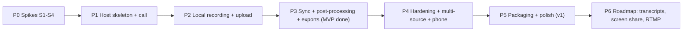

# p2p.video: Implementation Plan

Phases are ordered by risk. **Phase 0 spikes must finish first**: each answers a question that could change the architecture.
Task IDs (`SL-x.y`) are mirrored in [`../STATUS.md`](../STATUS.md). Each task is scoped to fit in one agent session (≈ 0.5–2 days of human work) and has a Definition of Done (DoD).

---

## Phase 0: Spikes (throwaway code under `spikes/`; the outputs are reports)

| ID | Task | DoD |
|---|---|---|
| **SL-0.1** | **S1 Funnel + TURN-TLS.** A minimal Go program: Pion echo peer + pion/turn TCP on 127.0.0.1:3478, exposed via `tailscale serve --tls-terminated-tcp=8443` + funnel. A browser on a phone hotspot (not on the tailnet) with `iceTransportPolicy:'relay'` connects and gets echoed video. Measure the max sustainable bitrate and RTT over Funnel. Also try the tsnet `ListenFunnel` + STUN-cookie demux on 443 as an alternative. | `docs/research/spike-s1-funnel-turn.md` with a works/doesn't verdict, measured kbps/RTT, and the exact serve commands |
| **SL-0.2** | **S2 Alignment accuracy.** A Go `align` prototype: take a WAV, simulate the "local" copy (48k PCM) and the "reference" copy (Opus 32 kbps through a lossy-network simulation: jitter, packet loss 2%, 40 ppm drift, 180 ms offset). Run GCC-PHAT windows plus a robust fit. Then repeat with a real two-browser recording. | Report with error distribution; target < 5 ms p99 over 60 min synthetic |
| **SL-0.3** | **S3 Browser recording.** A static page: 1080p30 capture, WebCodecs+Mediabunny fMP4 and MediaRecorder paths, OPFS chunk writes, while also sending a 540p WebRTC stream to a loopback peer. Test on Chrome, Safari 18.4+, Firefox (M1 Air if available). Record dropped frames, CPU, OPFS throughput, and AEC-per-track behaviour. Include iOS Safari as a phone sub-source (backgrounding, wake lock). | Capability matrix table in `spike-s3-browser-recording.md` + a recommended recorder per browser |
| **SL-0.4** | **S4 FCPXML multicam.** Hand-write, then generate, an FCPXML 1.10 with a 3-angle multicam from 3 test clips with known offsets. Import into FCP. Also produce an xmeml and import into Resolve/Premiere (if available). | Golden files committed to `testdata/export/`; screenshots; notes on required attributes |

**Gate:** update ARCHITECTURE.md / DECISIONS.md with the spike results before starting P1.

---

## Phase 1: Host skeleton + live call

| ID | Task | Depends | DoD |
|---|---|---|---|
| SL-1.1 | Scaffold the Go module `host/`, `cmd/p2pvideod`, config, structured logging (slog), `--dev` mode serving on `localhost:7443` with a self-signed cert or plain localhost | — | `go run ./cmd/p2pvideod --dev` serves a hello page; `go test ./...` passes; CI workflow (GitHub Actions macOS) |
| SL-1.2 | `internal/store`: SQLite (modernc) + migrations + repository functions for sessions/participants/sources | 1.1 | Unit tests for CRUD |
| SL-1.3 | Scaffold `web/` (Vite + Svelte 5 + TS + vitest + Playwright). `make web` builds into `host/web/`, embedded via `embed.FS` | 1.1 | The binary serves the SPA; `npm test` passes |
| SL-1.4 | Session API + invite tokens + admission flow (HTTP + WS hub, `protocol.go`, TS mirror + contract tests) | 1.2, 1.3 | A guest can request; the host admits or denies; e2e test with 2 fake browsers |
| SL-1.5 | `internal/sfu`: Pion SFU (publish/subscribe, renegotiation, PLI forwarding), single UDP mux port, bitrate caps | 1.4 | 3 Playwright fake-media clients see each other; 10-min soak with no leaks |
| SL-1.6 | Green room UI (devices, preview, level meter, capability + storage checks) and studio grid UI | 1.4 | Manual + Playwright smoke |
| SL-1.7 | `internal/tailscale`: LocalAPI client, onboarding checks, apply/remove serve+funnel config, discover the `*.ts.net` name | 1.1, S1 | `p2pvideo doctor` prints check results; `p2pvideod` exposes the app on the ts.net URL |
| SL-1.8 | `internal/turn`: pion/turn on loopback TCP behind funnel 8443, HMAC credentials, ICE config delivery | 1.5, 1.7 | A guest on cellular with `relay` policy joins the call |
| SL-1.9 | Host dashboard (localhost/tailnet-identity only): participants, connection path (from `getStats` reported by clients), admit/kick | 1.5 | Dashboard unreachable via Funnel (test) |

**Milestone M1:** a 3-person call with a remote guest over Funnel. No recording yet.

---

## Phase 2: Local recording + upload

| ID | Task | Depends | DoD |
|---|---|---|---|
| SL-2.1 | `lib/capture`: preset constraints; single full-res capture with the sender downscaled via `setParameters` | 1.6 | Recording track 1080p while the call sends ≤ 540p (verified by stats) |
| SL-2.2 | `Recorder` interface + `MediaRecorderRecorder` (mp4 → webm fallback, timeslice 1 s) | 2.1 | Unit tests with mocked MediaRecorder; real Chrome produces playable chunks |
| SL-2.3 | `lib/storage` OPFS chunk store in a worker (SyncAccessHandle), IDB fallback, `storage.persist()` | — | Writes 10 MB/s sustained in Chrome; recovery listing works after reload |
| SL-2.4 | `internal/upload` chunk API (PUT/complete/status), checksum, idempotency, quotas, SQLite rows, assembly | 1.2 | Go tests: duplicate, out of order, hash mismatch, resume ranges |
| SL-2.5 | `lib/upload` queue: concurrency, throttle from `getStats`, resume via the status endpoint, post-stop burst | 2.3, 2.4 | Playwright: cut network 60 s mid-take → complete, byte-identical to the local copy |
| SL-2.6 | Record start/stop protocol: scheduled `startAtHostUs`, countdown UI, takes table, per-track status reporting to the dashboard | 2.2, 1.9 | Host starts/stops; every client records; dashboard shows bytes/progress |
| SL-2.7 | Recovery UI: leftover-takes screen, resume upload, purge after host ack | 2.5 | Kill tab mid-take, reopen link → data uploaded, loss ≤ 2 s |
| SL-2.8 | `WebCodecsRecorder` (Chromium/Safari): H.264 HW encode + Mediabunny fMP4 + per-frame timestamps | 2.2, S3 | 60-min 1080p30 with 0 dropped frames on an M-series Mac; output plays in QuickTime |

**Milestone M2:** every participant's files arrive at the host intact (not yet aligned).

---

## Phase 3: Sync + post-processing + exports (MVP complete)

| ID | Task | Depends | DoD |
|---|---|---|---|
| SL-3.1 | `lib/clock` ping loop over a DataChannel (WS fallback), line fit, sidecar writer; host `internal/clock` | 2.6 | Offset estimate within 2 ms on localhost tests |
| SL-3.2 | `internal/refrec`: write each publisher's received Opus to OGG + an RTP-to-host-time map | 1.5 | Reference files play back; timestamps monotonic |
| SL-3.3 | `internal/align`: GCC-PHAT + robust fit (productionize S2), coarse fallback | 3.1, 3.2, S2 | Synthetic tests: < 1 ms error at 40 ppm drift and 2% loss |
| SL-3.4 | `internal/ffmpeg`: discovery, capability probe (`-encoders`), argv builders (CFR VideoToolbox, ProRes, soxr drift resample, timecode) | — | Golden argv tests; real conversion of a VFR sample to CFR |
| SL-3.5 | `internal/postproc`: job DAG, resumable, logs, host notification | 3.3, 3.4, 2.4 | `p2pvideo postprocess <take>` produces `out/` from a recorded take |
| SL-3.6 | `export/manifest` + `export/fcpxml` (multicam, from S4) | 3.5, S4 | Golden tests; opens in FCP as a synced multicam |
| SL-3.7 | `export/xmeml` (Premiere/Resolve) | 3.5 | Golden tests; imports in Resolve |
| SL-3.8 | Sync validation tool `p2pvideo synctest` + Playwright e2e (fake chirp audio) asserting residual < 5 ms | 3.5 | Runs in CI |

**Milestone M3 (MVP):** record a real remote episode → open the FCPXML → cut with no manual sync.

---

## Phase 4: Hardening + multi-source + phone

| ID | Task | DoD |
|---|---|---|
| SL-4.1 | Multiple sources per participant (extra cameras/mics), `source_add`, separate tracks | 2 cams + 1 mic on one Mac, all aligned in output |
| SL-4.2 | Phone sub-source via QR (`?source_of=`), mini preview tile, wake lock, background warning | iPhone angle arrives aligned |
| SL-4.3 | `PcmWorkletRecorder`: lossless WAV audio path | Delivered WAV bit-identical to captured PCM (test with fake audio) |
| SL-4.4 | Direct UDP for Funnel guests: optional STUN (policy flag) + UPnP/NAT-PMP port mapping + `SetNAT1To1IPs` | Dashboard shows "direct" for a guest on typical home NAT |
| SL-4.5 | Sync chirp button + producer role + per-session auto-admit + Funnel on/off toggle | — |
| SL-4.6 | Security pass: rate limits, quotas, token expiry, dashboard isolation tests, fuzz the upload handler | Checklist in `docs/security-review.md` |
| SL-4.7 | Safari + Firefox fallbacks verified; compatibility messaging | Matrix in README |
| SL-4.8 | Manual QA checklist `docs/qa-checklist.md` + a real 60-min, 4-person test session | Signed-off checklist |

## Phase 5: Packaging + polish (v1)
| ID | Task | DoD |
|---|---|---|
| SL-5.1 | Go systray menu-bar app, login item, open dashboard, session quick actions | — |
| SL-5.2 | `.app` bundle, codesign + notarize script, Homebrew cask | Installs on a clean Mac |
| SL-5.3 | ffmpeg acquisition flow (brew detect / LGPL download) | Works with no brew installed |
| SL-5.4 | Onboarding wizard UI (Tailscale checks with fix-its; ACL snippet for funnel) | A new user goes from install to first session in < 10 min |
| SL-5.5 | Docs: user guide, guest FAQ ("why keep tab open"), troubleshooting | — |
| SL-5.6 | (Optional) SwiftUI wrapper `macapp/` replacing the systray | — |

## Phase 6: Roadmap
- SL-6.1 Screen share as a recorded source.
- SL-6.2 Transcripts: run the **Minutes** speech engine (FluidAudio Parakeet) on each aligned WAV and emit per-speaker SRT/JSON plus a transcript-based "text edit" view.
- SL-6.3 RTMP/SRT live output (host composites via ffmpeg, or a browser-side compositor canvas).
- SL-6.4 tsnet embedding (no Tailscale.app dependency).
- SL-6.5 Native capture of host cameras via the Swift wrapper (Continuity Camera, ProRes).
